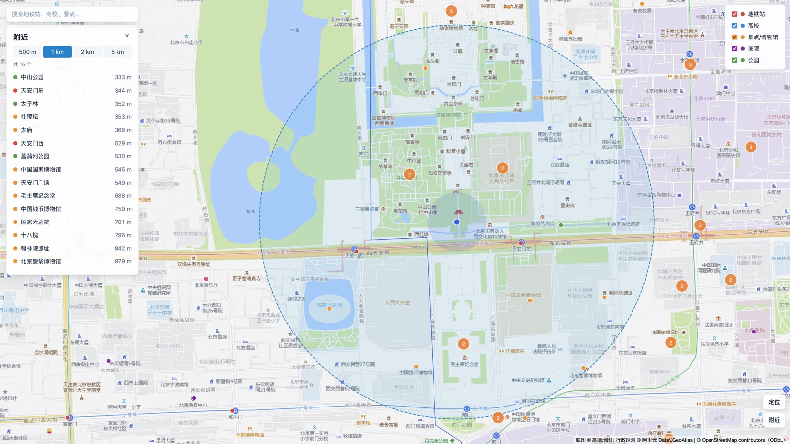
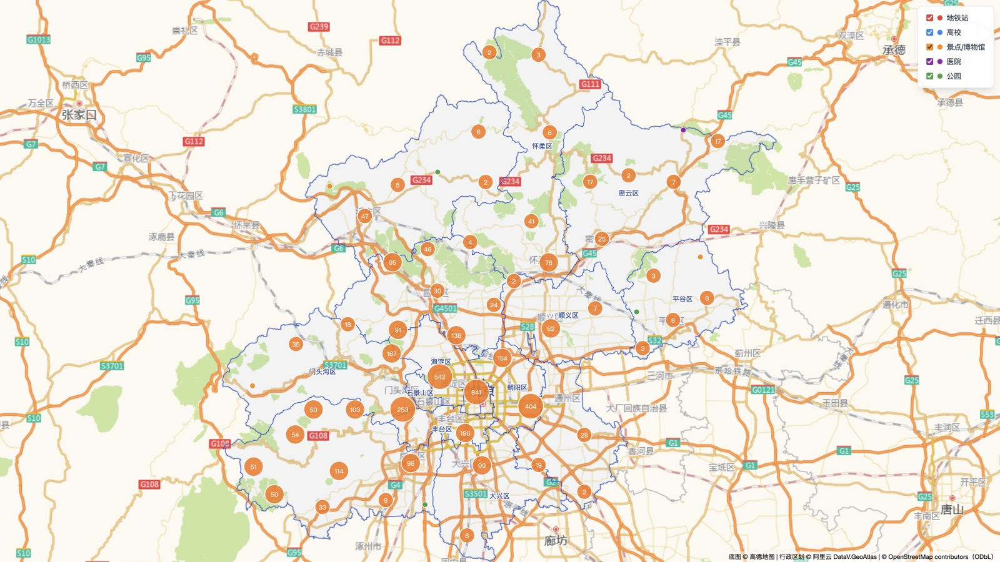
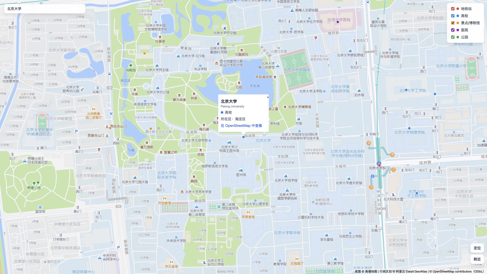
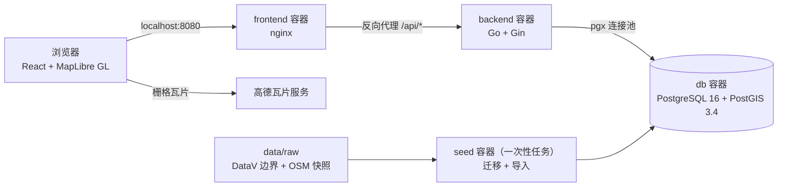

# beijing-geo-map

[](https://github.com/slatt-oo/beijing-geo-map/actions/workflows/ci.yml)

一个基于 PostgreSQL + PostGIS、Go 和 React + MapLibre GL 的北京市地图 Demo：渲染北京 16 个区的边界，并支持 POI 标注、浏览器定位与「我在哪个区」、名称搜索和附近查询。clone 之后执行一条 `docker compose up --build` 就能在本机完整运行。



> **状态：第一版已完成。** 可以继续扩展的方向见[实现文档](docs/01-implementation-plan.md#6-后续阶段第一版不做)。

## 功能

- **行政区边界**：16 个区的边界，悬停高亮，点击查看面积和各类 POI 数量。
- **我的位置**：浏览器定位，并反查所在的区；定位失败时可以在地图上点选。桌面版 Chrome 在国内通常无法定位，建议使用 Safari。
- **POI 标注**：地铁站、高校、景点/博物馆、医院、公园五类，按视野加载、聚合、分类筛选。
- **搜索**：按名称模糊搜索，选中后地图飞到该点。
- **附近查询**：以当前位置或地图上任意一点为中心，查询 500 米到 5 千米内的 POI，按距离排序。

| 全市视野 | 搜索「北京大学」 |
|---|---|
|  |  |

各阶段的验收截图和逐项记录在 [docs/screenshots/](docs/screenshots/) 下。

## 快速开始

只需要安装 Docker（包含 Docker Compose v2）：

```bash
git clone https://github.com/slatt-oo/beijing-geo-map.git
cd beijing-geo-map
docker compose up --build
```

启动后访问 <http://localhost:8080>。第一次启动要下载基础镜像、安装依赖并构建，通常需要几分钟；PostGIS 镜像只有 amd64 版本，在 Apple Silicon 的 Mac 上通过模拟运行，数据库启动会再慢一些。

首次启动时，`seed` 服务会先执行数据库迁移，再导入 `data/raw/` 下的数据快照，完成后后端才会启动。数据快照已经提交在仓库里，启动时不需要从外部下载数据。之后每次 `docker compose up` 都会重新导入一遍，导入是幂等的，不会产生重复数据。

端口、数据库账号和构建镜像时的依赖源都可以在 `.env` 中修改，参见 `.env.example`。例如 8080 端口被占用时，可以用 `FRONTEND_PORT=8090 docker compose up --build`。数据库端口只绑定在本机 127.0.0.1，局域网内的其他机器访问不到；如果 5432 端口已被占用（例如本机装了 PostgreSQL），可以用 `DB_PORT` 换一个端口。

## 架构



- **数据统一使用 WGS-84。** 高德底图使用 GCJ-02 坐标系，前端只在把数据交给地图时转换坐标，从地图上取到的坐标先换算回 WGS-84 再查询。
- **接口返回 GeoJSON。** 区边界由 PostGIS 生成 GeoJSON，Go 原样透传；POI 按视野查询，在前端聚合显示。
- **空间查询都有索引支撑。** 点在面内（`ST_Contains`）、视野范围（GIST 索引）、按距离查询（`geography` 表达式索引）和名称模糊搜索（`pg_trgm`）。

详细设计见下面的文档。

## 技术栈

| 层 | 选型 |
|---|---|
| 数据库 | PostgreSQL 16 + PostGIS 3.4、pg_trgm |
| 后端 | Go 1.26、Gin、pgx v5、golang-migrate |
| 前端 | React 19、TypeScript 6、Vite 8、MapLibre GL JS、TanStack Query、Zustand、Tailwind CSS 4 |
| 运行与 CI | Docker Compose、GitHub Actions |

## 更换底图

高德瓦片地址不是官方开放接口，可能不可用或被限制。底图地址、坐标系和署名都可以在构建前端镜像时更换，例如换成 OpenStreetMap 的瓦片（使用时请遵守其[瓦片使用政策](https://operations.osmfoundation.org/policies/tiles/)）：

```bash
VITE_TILE_URL='https://tile.openstreetmap.org/{z}/{x}/{y}.png' \
VITE_TILE_CRS=wgs84 \
VITE_TILE_ATTRIBUTION='底图 © OpenStreetMap contributors' \
docker compose up --build
```

`VITE_TILE_CRS=wgs84` 表示底图本身就是 WGS-84，前端不再做坐标转换；只能填 `gcj02` 或 `wgs84`，填错时前端镜像会构建失败。这三个变量也可以写在 `.env` 里。

## 常见问题

- **定位失败**：桌面版 Chrome 依赖的 Google 定位服务在国内通常不可用，页面会提示在地图上点选位置；Safari 使用苹果的定位服务，可以正常定位。
- **页面提示「后端服务未启动或暂时不可用」**：用 `docker compose ps` 查看各服务状态，用 `docker compose logs seed backend` 查看导入和后端的日志。后端恢复后点击提示条里的「重试」即可，不需要刷新页面。
- **页面提示「底图加载失败」**：浏览器连不上瓦片服务，区边界和 POI 仍然可以使用。可以检查网络，或者按上一节更换底图。
- **页面显示「地图无法显示」**：浏览器创建不了 WebGL 上下文。请开启浏览器的硬件加速，或者换用最新版的 Chrome、Edge、Safari、Firefox。
- **端口被占用**：用 `FRONTEND_PORT`、`DB_PORT` 换端口，见「快速开始」。

## 本地开发

本地开发时不需要构建整套镜像（`make dev-db` 只会构建一次导入数据用的后端镜像），需要本机安装 Go 和 Node.js（版本见[技术方案 3.4 节](docs/02-technical-design.md#34-版本与依赖源)）：

```bash
make dev-db           # 启动数据库，并通过 seed 服务完成迁移和数据导入
make run-backend      # 启动后端，监听 localhost:8000
make run-frontend     # 启动前端开发服务器，/api 会被代理到 localhost:8000
make test             # 运行前后端单元测试
make test-integration # 运行数据库集成测试（需要先 make dev-db），测试使用独立的 geo_test_* 数据库
```

`Makefile` 会读取 `.env`，所以在 `.env` 里修改 `DB_PORT` 或数据库账号后，本地开发命令也会使用新的设置。数据快照的来源、许可和更新方法见 [data/README.md](data/README.md)。临时覆盖某个值时请写成 `make run-backend DB_PORT=15432`：在 make 中，`.env` 的值优先于 shell 环境变量。`.env` 中的值不要加引号，也不要在行尾写注释。

## 文档

1. [实现文档](docs/01-implementation-plan.md)：目标、功能范围、数据来源、阶段计划、风险。
2. [技术方案](docs/02-technical-design.md)：架构、坐标系方案、后端接口、导入器、前端、测试与 CI。
3. [数据库设计](docs/03-database-design.md)：ER 图、表结构、索引、典型 SQL、设计取舍、扩展表设计。

## 数据来源与声明

- POI 数据 © [OpenStreetMap](https://www.openstreetmap.org/copyright) contributors，遵循 ODbL 协议。
- 行政区划边界来自 [阿里云 DataV.GeoAtlas](https://datav.aliyun.com/portal/school/atlas/area_selector)。
- 底图 © 高德地图。本项目使用的高德瓦片地址不是官方开放接口，仅用于学习和非商业演示。

## 许可

代码以 [MIT](LICENSE) 协议发布。数据遵循各自来源的许可协议。
