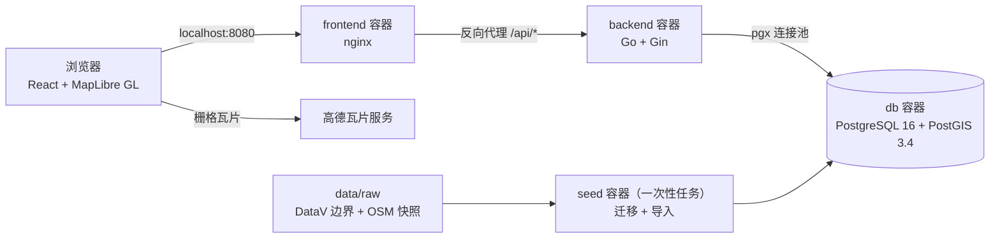

# 技术方案：北京地图 Demo（beijing-geo-map）

> 本文说明系统「怎么实现」。功能范围和阶段计划见 [01-implementation-plan.md](01-implementation-plan.md)，表结构和 SQL 见 [03-database-design.md](03-database-design.md)。

## 1. 架构总览



**核心选择：REST 接口返回 GeoJSON。** 区边界在 SQL 里用 `ST_AsGeoJSON` 生成，Go 代码原样透传；POI 的点坐标由 SQL 以数值返回，service 组装成 GeoJSON Point。前端拿到 GeoJSON 后直接交给 MapLibre 渲染。点聚合在前端完成，坐标转换也集中在前端。

之所以不用 MVT 矢量瓦片：第一版只有约 4000 条 POI，GeoJSON 完全够用；而且底图是 GCJ-02，如果用矢量瓦片，就必须在 SQL 里先做坐标偏移再切片，复杂度明显过剩。数据量大幅增长后再升级为矢量瓦片，见实现文档的「后续阶段」。

**服务启动顺序**：

1. `db` 健康检查通过。
2. `seed` 执行迁移和导入，成功后退出。
3. `backend` 在 `seed` 成功结束后启动（`depends_on.condition: service_completed_successfully`）。
4. `frontend` 启动。

浏览器只访问 `frontend` 这一个地址，`/api` 由 nginx 反向代理到后端，因此不存在跨域问题。

## 2. 仓库结构

```text
beijing-geo-map/
├── README.md
├── LICENSE
├── docker-compose.yml
├── .env.example                # 所有可配置项及默认值
├── Makefile                    # 常用命令入口
├── .github/workflows/ci.yml
├── docs/                       # 实现文档、技术方案、数据库设计、各阶段验收截图（screenshots/）
├── testdata/
│   └── coord_cases.json        # 前后端共享的坐标转换测试样例
├── data/
│   ├── README.md               # 数据来源、许可、快照日期
│   └── raw/
│       ├── beijing_districts_gcj02.json   # DataV 原始文件
│       └── beijing_pois_osm.json          # Overpass 导出的快照
├── scripts/
│   └── fetch_osm_pois.sh       # 重新拉取 OSM 快照（手动运行）
├── backend/
│   ├── go.mod                  # module github.com/slatt-oo/beijing-geo-map/backend
│   ├── Dockerfile              # 一个镜像同时包含 server 和 importer 两个二进制
│   ├── cmd/
│   │   ├── server/main.go      # HTTP 服务入口
│   │   └── importer/main.go    # 迁移 + 导入入口
│   ├── migrations/
│   │   ├── migrations.go       # 用 embed.FS 把 SQL 文件打包进二进制
│   │   ├── 000001_init.up.sql / .down.sql
│   │   └── 000002_seed_poi_categories.up.sql / .down.sql
│   └── internal/
│       ├── config/             # 从环境变量读取配置
│       ├── geo/                # WGS-84 与 GCJ-02 互转
│       ├── model/              # 接口返回的数据结构
│       ├── repository/         # SQL 查询（pgx）
│       ├── service/            # 业务规则：默认值、上限、分类编码映射
│       ├── handler/            # 路由、参数校验、响应和错误格式
│       └── importer/           # 解析 DataV / OSM 文件并写库
└── frontend/
    ├── package.json
    ├── vite.config.ts          # 开发模式下把 /api 代理到 localhost:8000
    ├── nginx.conf              # 生产模式下托管静态文件，并反向代理 /api
    ├── Dockerfile              # 多阶段构建：Node 构建，nginx 运行
    └── src/
        ├── main.tsx / App.tsx
        ├── config.ts           # 底图地址、坐标转换函数、初始视野和地图可视范围
        ├── api/                # fetch 封装、接口类型、TanStack Query hooks
        ├── lib/                # coord.ts、geojson.ts、bbox.ts、tiles.ts 等纯函数
        ├── map/                # 地图实例、图层定义、各图层组件、点击分发、POI 弹窗、右键菜单
        ├── store/              # Zustand 全局状态；定位流程（locate.ts，失败时转入点选）
        ├── hooks/              # useDebounce
        └── components/         # 搜索框、区详情面板、附近面板、POI 详情卡片、分类开关、定位和附近按钮、点选提示、提示条、页面级错误边界
```

## 3. 运行与配置

### 3.1 Docker Compose 服务

| 服务 | 镜像 | 作用 | 对外端口 |
|---|---|---|---|
| `db` | `postgis/postgis:16-3.4` | 数据库，数据存放在命名卷 `pgdata` 中 | `127.0.0.1:${DB_PORT:-5432}`，只绑定本机，方便本地调试 |
| `seed` | 与 backend 共用一个镜像 | 执行 `importer`，完成后退出；`./data/raw` 以只读方式挂载到 `/data` | 无 |
| `backend` | 本仓库 `backend/Dockerfile` | 执行 `server` | 不对外暴露，只在容器网络内访问 |
| `frontend` | 本仓库 `frontend/Dockerfile` | nginx 托管前端并反向代理 `/api` | `${FRONTEND_PORT:-8080}` |

### 3.2 环境变量

| 变量 | 使用方 | 默认值 | 说明 |
|---|---|---|---|
| `POSTGRES_USER` / `POSTGRES_PASSWORD` / `POSTGRES_DB` | db、Makefile（拼出本地连接串） | `geo` / `geo` / `geo` | 仅供本地 Demo 使用 |
| `DATABASE_URL` | backend、seed | `postgres://geo:geo@db:5432/geo?sslmode=disable` | 数据库连接串 |
| `HTTP_ADDR` | backend | `:8000` | 监听地址 |
| `LOG_LEVEL` | backend、seed | `info` | 日志级别 |
| `DATA_DIR` | seed | `/data` | 数据快照所在目录 |
| `TEST_DATABASE_URL` | 集成测试 | 无（`make test-integration` 会自动设置） | 管理连接串。测试会在同一个服务器上创建并使用 `geo_test_<name>` 数据库（name 由各测试包指定），不会改动开发库 |
| `VITE_TILE_URL` | frontend（构建时） | 高德瓦片地址 | 底图瓦片模板，`{s}` 会展开为 1 到 4 号子域名 |
| `VITE_TILE_CRS` | frontend（构建时） | `gcj02` | 底图坐标系；设为 `wgs84` 时关闭坐标转换。只能是这两个值，否则前端构建失败 |
| `VITE_TILE_ATTRIBUTION` | frontend（构建时） | `底图 © 高德地图` | 地图右下角的底图署名，更换底图时一并修改 |
| `DB_PORT` / `FRONTEND_PORT` | compose；Makefile 也读取 DB_PORT | `5432` / `8080` | 映射到宿主机的端口 |
| `GOPROXY` | backend 镜像构建 | `https://goproxy.cn,direct` | Go 模块代理；CI 中设为 `https://proxy.golang.org,direct` |
| `NPM_REGISTRY` | frontend 镜像构建 | `https://registry.npmjs.org/` | npm 源；国内可以改为 `https://registry.npmmirror.com/` |

`VITE_*` 变量在构建时就写进前端代码，所以要通过 Docker 的 `build.args` 传入。根目录 `.env` 中的 `VITE_TILE_URL`、`VITE_TILE_CRS`、`VITE_TILE_ATTRIBUTION` 只在构建镜像时生效；本地开发模式（`make run-frontend`）下要写在 `frontend/.env` 中，或者写在命令前面，例如在 `frontend/` 目录下运行 `VITE_TILE_CRS=wgs84 npm run dev`。

### 3.3 本地开发模式

开发时不需要每次都构建整套镜像（`make dev-db` 只会构建导入数据用的后端镜像）：

```bash
make dev-db          # 启动 db 容器并等待健康检查通过，再运行一次 seed 服务完成迁移和导入
make run-backend     # go run ./cmd/server，连接本机的数据库端口
make run-frontend    # npm run dev，由 Vite 把 /api 代理到 localhost:8000
```

其他常用命令：`make up` / `make down` / `make logs` / `make seed`（重新导入） / `make test` / `make test-integration` / `make lint` / `make fetch-osm`（更新 POI 快照）。

`Makefile` 会读取 `.env`，本地连接串由 `POSTGRES_USER`、`POSTGRES_PASSWORD`、`POSTGRES_DB`、`DB_PORT` 拼出。`make test-integration` 把这个连接串作为 `TEST_DATABASE_URL` 传给测试，每个测试包在同一个服务器上创建并使用自己的 `geo_test_<name>` 数据库，不会改动开发库里已导入的数据。

### 3.4 版本与依赖源

- **Go 1.26**：`go.mod` 声明 `go 1.26.0`。Gin v1.12 和 pgx v5.11 要求 Go 1.25 以上，gin-contrib/gzip v1.2.8 要求 Go 1.26 以上。本机的 Go 1.21 会根据 `go.mod` 自动下载 1.26 工具链（`GOTOOLCHAIN=auto`），不需要手动升级。Docker 构建使用 `golang:1.26-alpine`，CI 中的 `setup-go` 从 `go.mod` 读取版本。
- **前端**：React 19、Vite 8、Vitest 5、ESLint 10、Tailwind CSS 4，Node 24。TypeScript 固定为 `~6.0.3`：typescript-eslint 8 只支持到 TypeScript 6.0，暂时不能升级到 7.0。
- **npm 源**：`frontend/.npmrc` 固定使用 `https://registry.npmjs.org/`，保证 `package-lock.json` 中只有公共源地址，GitHub CI 和其他人 clone 后都能正常安装。
- **镜像构建时的依赖源**：通过构建参数 `GOPROXY` 和 `NPM_REGISTRY` 配置，默认值见上方环境变量表。
- **PostGIS 镜像**：`postgis/postgis:16-3.4` 只提供 amd64 版本。compose 中显式声明 `platform: linux/amd64`，在 Apple Silicon 上通过模拟运行，功能不受影响，只是启动稍慢。
- **数据库健康检查**：`pg_isready` 必须加 `-h 127.0.0.1` 走 TCP。官方镜像初始化阶段的临时实例只监听 unix socket，不加这个参数会在初始化完成之前就被判定为健康。

## 4. 坐标系方案

### 4.1 问题是什么

| 坐标系 | 谁在用 |
|---|---|
| WGS-84 | GPS、浏览器定位、OpenStreetMap，以及 GeoJSON 标准（RFC 7946） |
| GCJ-02 | 高德地图、腾讯地图，以及 DataV 的边界数据 |

GCJ-02 是在 WGS-84 的基础上做了非线性偏移，在北京偏移量大约是几百米。如果把 WGS-84 的点直接画在高德底图上，就会整体偏离道路。

### 4.2 原则：数据层永远是 WGS-84，只在显示层转换

| 位置 | 坐标系 |
|---|---|
| 数据库、后端接口 | 一律 WGS-84 |
| 导入时 | DataV 边界在导入阶段由 Go 从 GCJ-02 转成 WGS-84；OSM 数据本来就是 WGS-84，无需转换 |
| 前端显示 | 算法在 `src/lib/coord.ts`；`src/config.ts` 按 `VITE_TILE_CRS` 导出 `toDisplay()` / `toData()`，其他模块只通过这两个函数转换 |

前端的转换只发生在两个出入口：

| 数据流向 | 转换 |
|---|---|
| 接口数据（WGS-84）要交给地图数据源 | `toDisplay()`：WGS-84 转 GCJ-02 |
| 用户在地图上点击得到的坐标（与底图对齐，是 GCJ-02），要拿去查询 | `toData()`：GCJ-02 转 WGS-84 |
| 浏览器定位得到的坐标（WGS-84） | 查询时直接用；显示时调用 `toDisplay()` |

当 `VITE_TILE_CRS=wgs84` 时，这两个函数都直接返回原坐标。

### 4.3 算法

- **正向（WGS-84 转 GCJ-02）**：使用公开的标准算法，基于克拉索夫斯基椭球参数，`a = 6378245.0`，`ee = 0.00669342162296594323`。
- **反向（GCJ-02 转 WGS-84）**：没有解析解，采用迭代法。以 `w = g` 作为初值，每轮执行 `w = w - (forward(w) - g)`，直到误差小于 `1e-7` 度（约 1 厘米）或者迭代满 10 轮。
- **中国境外**：经度不在 72.004 到 137.8347 之间，或纬度不在 0.8293 到 55.8271 之间时，原样返回，这是该算法的标准处理方式。

### 4.4 前后端一致性

Go 的 `internal/geo` 和前端的 `coord.ts` 实现同一套算法，并且都读取仓库根目录下的 `testdata/coord_cases.json`。样例文件中每条记录包含名称、WGS-84 坐标和 GCJ-02 坐标，覆盖天安门、鸟巢、北京大学、首都机场，以及东、西、南、北四个方向的中国境外点（东京、塔什干、雅加达、雅库茨克）。前端的反向转换与 Go 的循环逐步一致：每轮都调用带境外判断的正向转换。

样例值由广泛使用的开源库 [gcoord](https://github.com/hujiulong/gcoord) 生成，文件中会注明它的版本号。断言容差为：正向 `1e-6` 度；反向是 `forward(inverse(g))` 与 `g` 相差小于 `1e-6` 度。

## 5. 后端设计

### 5.1 分层与职责

| 层 | 包 | 职责 | 不做什么 |
|---|---|---|---|
| 接入层 | `handler` | 路由注册，解析和校验参数，把结果或错误写成 HTTP 响应 | 不写 SQL，不包含业务默认值 |
| 业务层 | `service` | 各参数的默认值和上限常量；分类编码到 ID 的映射（第一次使用时加载并缓存，加载失败会在下次调用时重试）；组装返回结构（GeoJSON 和 `{"data": ...}`） | 不接触 HTTP |
| 数据层 | `repository` | 用 pgx 执行参数化 SQL；区边界以 `ST_AsGeoJSON` 字符串返回，点坐标以数值返回 | 不解析几何 |

`handler` 依赖 `service` 的接口，而不是具体实现，所以 handler 测试可以注入一个假的 service。`main.go` 负责组装依赖：先读取配置，再创建 `pgxpool`，然后依次创建 repository、service、handler，最后启动 `http.Server`。收到 `SIGTERM` 时优雅关闭，等待正在处理的请求完成，最长 10 秒。

### 5.2 中间件

| 中间件 | 作用 |
|---|---|
| 请求日志 | 用 `slog` 输出 JSON 格式日志，记录方法、路径、查询参数、状态码和耗时。`/districts/locate` 和 `/pois/nearby` 的查询参数是用户的精确位置，记为 `[redacted]`；nginx 不为 `/api/` 写访问日志，避免绕过这条规则 |
| panic 恢复 | 捕获 panic 并记录堆栈，返回统一格式的 500 |
| 超时 | 每个请求带 5 秒 `context` 超时，并传递到 SQL 查询 |
| gzip | 压缩 1 KB 以上的响应。区边界 GeoJSON 压缩前约 100 KB |

### 5.3 接口约定

- 所有接口都在 `/api/v1` 下，坐标一律是 WGS-84 的 `[经度, 纬度]`。
- 返回空间数据的接口直接返回 GeoJSON `FeatureCollection`，不包外层，这样 MapLibre 可以直接使用；`Content-Type` 为 `application/geo+json`。
- 其他接口统一返回 `{"data": ...}`。
- 下文接口示例中的数值仅作格式演示，不是真实数据；几何坐标数组做了省略。
- 错误统一返回：

```json
{ "error": { "code": "INVALID_PARAM", "message": "lat 必须在 -90 到 90 之间" } }
```

| code | HTTP 状态码 | 场景 |
|---|---|---|
| `INVALID_PARAM` | 400 | 参数缺失、格式错误或超出范围 |
| `NOT_FOUND` | 404 | 资源不存在 |
| `INTERNAL` | 500 | 未预期的错误，包括请求超过 5 秒超时。详细原因只写进日志，返回给前端的 message 固定为「服务器内部错误」 |
| `UNAVAILABLE` | 503 | 健康检查时数据库不可用 |

客户端在响应之前断开连接时（例如前端移动地图后取消了上一次查询），访问日志中的状态码记为 499（沿用 nginx 的约定），不写错误日志；客户端本身收不到这个响应。

### 5.4 接口清单

#### `GET /api/v1/health`

返回 `{"data": {"status": "ok", "db": "ok"}}`。数据库连不上时返回 503。

#### `GET /api/v1/districts`

返回 16 个区的 `FeatureCollection`。边界用 `ST_SimplifyPreserveTopology(geom, 0.0001)` 简化（约 10 米），坐标保留 6 位小数。

```json
{
  "type": "FeatureCollection",
  "features": [{
    "type": "Feature",
    "geometry": { "type": "MultiPolygon", "coordinates": [] },
    "properties": {
      "adcode": "110108", "name": "海淀区", "area_km2": 430.77,
      "poi_count": 812, "center": [116.2, 40.0]
    }
  }]
}
```

#### `GET /api/v1/districts/{adcode}`

- `adcode` 必须是 6 位数字，否则返回 400；找不到对应区时返回 404。
- 返回区详情：

```json
{ "data": {
  "adcode": "110108", "name": "海淀区", "area_km2": 430.77, "center": [116.2, 40.0],
  "poi_counts": [ { "code": "subway_station", "name": "地铁站", "count": 70 } ]
} }
```

#### `GET /api/v1/districts/locate?lng=&lat=`

- `lng` 和 `lat` 必填，并且必须在合法范围内。
- 点在某个区内时返回 `{"data": {"adcode": "110108", "name": "海淀区"}}`。
- 点不在北京范围内时返回 `{"data": null}`。这是正常结果，状态码仍是 200。

#### `GET /api/v1/poi-categories`

返回 `{"data": [{"code": "subway_station", "name": "地铁站", "color": "#E53935"}, ...]}`，按 `sort_order` 排序。

#### `GET /api/v1/pois?bbox=&categories=&limit=`

| 参数 | 规则 |
|---|---|
| `bbox` | 必填，格式为 `minLng,minLat,maxLng,maxLat`，要求 min 小于 max，且都在合法范围内 |
| `categories` | 可选，逗号分隔的分类编码；为空表示全部；包含未知编码时返回 400 |
| `limit` | 可选，默认 2000，取值 1 到 5000 |

返回 `FeatureCollection`：

- 每个 `Feature` 的 `id` 是 POI 的 ID，`properties` 包含 `{id, name, category}`。
- 返回体顶层始终带 `truncated` 字段（GeoJSON 规范允许在顶层添加自定义字段），结果多于 `limit` 时为 `true`。截断按 `md5(id)` 打散的固定顺序进行，各分类、各区域大致按比例保留，见数据库设计文档 6.4 节。

#### `GET /api/v1/pois/{id}`

返回 POI 详情。`id` 不是正整数时返回 400，不存在时返回 404。

```json
{ "data": {
  "id": 123, "name": "北京大学", "name_en": "Peking University",
  "category": { "code": "university", "name": "高校", "color": "#1E88E5" },
  "district": { "adcode": "110108", "name": "海淀区" },
  "location": [116.305, 39.99], "address": null,
  "tags": { "website": "https://www.pku.edu.cn" },
  "osm_url": "https://www.openstreetmap.org/way/123456"
} }
```

`district` 可能为 `null`，表示该 POI 位于边界数据之外。

#### `GET /api/v1/pois/search?q=&limit=`

| 参数 | 规则 |
|---|---|
| `q` | 必填，去掉首尾空格后长度为 1 到 50 个字符；不是合法的 UTF-8 或包含 NUL 字符时返回 400 |
| `limit` | 可选，默认 10，取值 1 到 20 |

- 用户输入中的 `\`、`%`、`_` 会先转义，再拼成 `%q%` 作为参数传给 `ILIKE`，避免被当成通配符。
- 排序规则：完全匹配优先，然后按相似度从高到低，再按名称从短到长。
- 返回 `{"data": [{"id", "name", "category", "district_name", "location"}]}`。

#### `GET /api/v1/pois/nearby?lng=&lat=&radius=&categories=&limit=`

| 参数 | 规则 |
|---|---|
| `lng` / `lat` | 必填，必须在合法范围内 |
| `radius` | 可选，单位米，默认 1000，取值 100 到 5000 |
| `categories` | 规则同 `/pois` |
| `limit` | 可选，默认 50，取值 1 到 100 |

返回 `FeatureCollection`，按距离从近到远排序：

- `properties` 包含 `{id, name, category, distance_m}`，其中 `distance_m` 取整到米。
- 返回体顶层附带 `"center": [lng, lat]` 和 `"radius": 1000`，前端用来绘制范围圆。

### 5.5 导入器设计（`cmd/importer` + `internal/importer`）

导入器按以下顺序执行：

1. **执行迁移**：用 golang-migrate 读取嵌入二进制的 SQL 文件，并升级到最新版本。
2. **在同一个事务内**完成以下步骤，任何一步失败都会整体回滚：
   1. **导入行政区**：解析 DataV 的 `FeatureCollection`。在 Go 里把每个坐标从 GCJ-02 转成 WGS-84，然后交给 SQL 完成修复和计算：`ST_MakeValid` 修复转换后可能出现的自相交，`ST_Multi(ST_CollectionExtract(..., 3))` 统一成 MultiPolygon，`ST_PointOnSurface` 计算标注点（保证落在面内），`ST_Area(geom::geography)` 计算面积。最后按 `adcode` upsert。
   2. **导入 POI**：解析 Overpass 返回的 JSON。节点取 `lat`/`lon`，线和关系取 `center`。然后依次进行分类映射、名称选择和地铁站去重，再丢弃坐标落在北京市边界外扩约 1° 范围（经度 114.4 到 118.5，纬度 38.4 到 42.1）以外的 POI，最后按 `(osm_type, osm_id)` upsert。OSM 中少数要素的中心点远在北京之外，例如整条长城的 relation，中心点在甘肃；清河农场飞地（北京管辖、位于天津境内）的 POI 仍在范围内，会保留。前端地图的可视范围与这个范围相同。
   3. **同步删除**：把范围过滤后所有 POI 的键写入临时表，删除数据库中不在其中的 POI：快照里已经没有的，以及落在范围外的。范围过滤后的 POI 少于 1000 条时，导入器直接报错退出，防止因为快照损坏而误删全部数据。
   4. **重算 `district_id`**：用一条 `UPDATE` 同时完成分配和清空：每个 POI 取包含它的区（多个区都包含时取 `adcode` 最小的，保证重复导入的结果稳定），不在任何区内的置为 `NULL`。
3. 输出统计信息：各表行数、各分类数量、`district_id` 填充率、同步删除的数量，以及因落在范围外而丢弃的数量。

**分类映射规则**：按下表顺序匹配，命中第一条就停止。

| 顺序 | 分类编码 | OSM 标签条件 |
|---|---|---|
| 1 | `subway_station` | `railway=station` 且 `station=subway`，或 `public_transport=station` 且 `subway=yes` |
| 2 | `university` | `amenity=university` |
| 3 | `hospital` | `amenity=hospital` |
| 4 | `attraction` | `tourism=attraction` 或 `tourism=museum` |
| 5 | `park` | `leisure=park` |

景点排在公园之前，所以像颐和园这种同时带有 `tourism=attraction` 标签的公园会归为「景点」。

**名称规则**：优先取 `name:zh`，没有就取 `name`，两者都为空时丢弃该条记录。`name_en` 取 `name:en`。`address` 由 `addr:*` 系列标签拼接而成，没有时为空。

**地铁站去重**：换乘站在 OSM 中经常每条线路一个节点。同名、且相距 300 米以内的地铁站只保留一条：节点类型优先，其次 `osm_id` 较小的。

**Overpass 查询语句**（由 `scripts/fetch_osm_pois.sh` 使用；请求必须带 User-Agent，失败时以 30 秒、60 秒、120 秒的间隔重试）：

```text
[out:json][timeout:180];
area["ISO3166-2"="CN-BJ"]["admin_level"="4"]->.bj;
(
  nwr["railway"="station"]["station"="subway"](area.bj);
  nwr["public_transport"="station"]["subway"="yes"](area.bj);
  nwr["amenity"~"^(university|hospital)$"]["name"](area.bj);
  nwr["tourism"~"^(attraction|museum)$"]["name"](area.bj);
  nwr["leisure"="park"]["name"](area.bj);
);
out center tags;
```

### 5.6 接口实测耗时

测量环境：Apple Silicon Mac，Colima，PostGIS 镜像在 amd64 模拟下运行，导入完整快照（16 个区、约 4100 个 POI）。经 nginx 访问，启用 gzip；每个接口请求 6 次，丢掉第 1 次预热，取后 5 次的中位数。测量日期：2026-10-14。

| 接口 | 耗时（毫秒） |
|---|---|
| `GET /districts` | 58 |
| `GET /districts/110108` | 7 |
| `GET /districts/locate?lng=116.397&lat=39.908` | 4 |
| `GET /poi-categories` | 3 |
| `GET /pois?bbox=115.4,39.4,117.6,41.1`（全市，截断为 2000 条） | 114 |
| `GET /pois?bbox=116.30,39.95,116.35,40.00`（约 5 千米见方） | 6 |
| `GET /pois/{id}` | 4 |
| `GET /pois/search?q=北京大学` | 6 |
| `GET /pois/nearby?lng=116.397&lat=39.908&radius=1000` | 7 |

模拟运行的数据库比原生运行慢，CI 和 Linux 服务器上的耗时会更短。

## 6. 前端设计

### 6.1 技术栈与状态划分

| 关注点 | 方案 |
|---|---|
| 地图 | 直接使用 `maplibre-gl`，配合几个自定义 hook，不额外套 React 地图封装库 |
| 服务端数据 | TanStack Query，负责缓存、加载状态和失败重试 |
| 交互状态 | Zustand。地图事件回调只注册一次，需要通过 `getState()` 读取最新状态，用 Context 处理这种场景会很别扭 |
| 样式 | Tailwind CSS |

Zustand store 中保存的状态：

| 字段 | 含义 |
|---|---|
| `hiddenCategories` | 当前关闭的 POI 分类编码，为空表示全部开启。记录关闭的而不是开启的分类，这样分类列表加载完成之前也有确定的状态 |
| `selectedDistrict` | 当前选中的区（`adcode`） |
| `activePoiId` | 当前打开详情弹窗的 POI |
| `notice` | 右上角提示条的内容，格式为 `{tone, message}`：`info` 为普通提示，4 秒后自动消失；`error` 为错误提示，一直显示到用户关闭或被新的提示替换 |
| `mode` | 当前模式：`normal`（普通）或 `pickLocation`（在地图上点选位置） |
| `locateRequest` | 正在等待的浏览器定位请求，为 `null` 表示没有。定位进行中不会再发起新的定位，「定位」按钮显示「定位中…」并暂时不可点击；等待期间用户点选了位置或取消点选时清空，这次请求的结果随之作废 |
| `myLocation` | 我的位置，格式为 `{lng, lat, accuracy}`，WGS-84；在地图上点选的位置没有精度，`accuracy` 为 `null` |
| `nearby` | 附近查询的中心和半径，格式为 `{center, radius}` 或 `null` |
| `nearbyAfterLocate` | 点击「附近」时还没有位置，会先定位；为 `true` 表示定位或点选完成后接着打开附近查询 |
| `contextMenu` | 右键菜单的位置（WGS-84），为 `null` 表示菜单关闭 |

### 6.2 页面布局

- 地图占满全屏。
- 左上角：搜索框，下面是浮动面板，显示区详情或附近查询结果，两者互斥：打开附近查询会取消选中的区；附近面板打开时，点击地图不会选中区，要查看区详情需要先关闭附近面板。搜索框和面板宽 320 像素，地图缩放到某个区或查询范围时，左侧留出 360 像素的边距。
- 右上角：提示条，下面是分类开关，用分类颜色标识。
- 顶部中间：POI 请求较慢时提示「正在加载 POI…」，结果被截断时提示「当前范围数据过多，请放大地图」。
- 右下角：「定位」和「附近」两个按钮。
- 底部中间：点选位置模式的提示和「取消」按钮。
- 右下角底部：MapLibre 的署名控件显示各数据源的署名：「底图 © 高德地图」「行政区划 © 阿里云 DataV.GeoAtlas」「© OpenStreetMap contributors（ODbL）」。

### 6.3 图层（从下往上）

| 图层 | 数据源 | 说明 |
|---|---|---|
| `basemap` | 高德栅格瓦片 | `tiles` 中列出 `webrd01` 到 `webrd04` 四个子域名 |
| `district-fill` | `/districts` | 半透明填充，悬停和选中时通过 `feature-state` 加深；数据源设置 `promoteId: "adcode"` |
| `district-line` / `district-label` | 同上 | 边线；区名标注在 `center` 位置 |
| `nearby-fill` / `nearby-line` | 前端计算 | 用 `@turf/circle` 生成 64 边形，显示查询范围：浅色填充加虚线边框 |
| `poi-cluster` / `poi-cluster-count` | `/pois` | 设置 `cluster: true`，聚合半径 50 像素，最大聚合级别 14 |
| `poi-point` | 同上 | 用分类颜色的圆点表示，颜色通过 `match` 表达式根据 `category` 取值 |
| `my-location-accuracy` / `my-location-dot` | store | 蓝色圆点；浏览器定位得到的位置还显示精度圈。精度圈同样用 `@turf/circle` 按 `accuracy` 的米数生成多边形，在任何缩放级别都与底图比例一致 |

所有数据在调用 `setData` 之前都要经过 `toDisplay()`，由 `lib/geojson.ts` 递归转换 GeoJSON 中的每个坐标。

所有数据源和图层在地图的 `style.load` 事件里一次建好（数据先为空），保证从下到上的顺序固定，之后只通过 `setData`、`setPaintProperty` 和 `setFeatureState` 更新。`style.load` 在样式解析完成、开始请求瓦片之前触发；如果等 `load`，就要等首屏所有底图瓦片加载完，接口请求会排在瓦片之后。区名标注使用单独的点数据源，由 `/districts` 返回的 `center` 生成。样式中不配置 `glyphs`：MapLibre 6 在没有字形地址时用浏览器本地字体绘制文字，区名和聚合数字都不依赖外部字形服务。

### 6.4 各功能的交互流程

**F1 行政区**

1. 页面首次加载时请求一次 `/districts`，结果长期缓存。
2. 鼠标移入时设置 `hover` 状态，并在鼠标旁显示区名提示。
3. 点击时设置 `selected` 状态，用 `fitBounds` 缩放到该区（左侧给面板留出边距），然后请求 `/districts/{adcode}`，在面板中展示面积和各分类数量。点击北京以外的地方会取消选中。

**F3 POI**

1. 地图 `moveend` 事件触发后防抖 300ms。
2. 取当前视野的四个角，分别经过 `toData()` 转换后取外包框，向外取整到 0.001°（约 100 米），再请求 `/pois`。`limit` 固定为 5000：当前约 4100 个 POI，全市视野也不会被截断，聚合数字才准确。
3. 请求参数（bbox 和分类）作为 TanStack Query 的缓存键，视野回到之前的位置时直接使用缓存；换视野时先保留旧数据，新数据到达后再替换。分类全部关闭时不发请求，直接清空图层。
4. 点击统一由一个处理函数分发，判断规则在 `lib/clickRoute.ts`：点选位置模式下任何点击都用来设置位置；否则先查 POI 图层，再查区图层，所以点击区内的 POI 不会同时选中区。点击聚合圆时调用 `getClusterExpansionZoom` 放大；点到 POI 以外的地方会关闭详情弹窗；附近面板打开时，这样的点击只关闭弹窗，不会选中区，以免丢掉附近结果。
5. 点击单个点时请求 `/pois/{id}`，并在 maplibre `Popup` 中通过 React portal 渲染详情：名称、英文名、分类、所在区和 OSM 链接。地址由 OSM 标签拼接而成，质量参差不齐，第一版不显示。
6. 结果被截断时（`truncated`），提示「当前范围数据过多，请放大地图」。请求超过 400 毫秒还没有返回时，同一位置改为提示「正在加载 POI…」；本地请求通常几十毫秒就返回，不会每次移动地图都闪一下。

**F2 我的位置**

1. 点击定位按钮，按钮变为「定位中…」并暂时不可点击，同时调用 `navigator.geolocation.getCurrentPosition`（启用高精度，10 秒超时，不使用缓存的位置）。同一时间只有一次定位请求；等待期间用户已经点选位置或取消点选时，这次请求的结果作废，不会再次进入点选模式。浏览器 20 秒内没有任何回应（例如授权弹窗被关掉）时按定位失败处理。`localhost` 属于安全上下文，可以直接使用定位接口。
2. 定位成功：写入 `myLocation`，地图飞到该位置（缩放级别至少 14），显示蓝点和精度圈，请求 `/districts/locate`，提示「你在海淀区」，或者「当前位置不在北京市范围内」。
3. 定位失败、用户拒绝授权或浏览器不支持定位：进入 `pickLocation` 模式，底部显示「浏览器定位失败，请在地图上点击你的位置」和「取消」按钮。点选模式下鼠标显示为十字，任何点击都用来设置位置，不会打开 POI 或选中区，右键也不弹出菜单。点击后把坐标经 `toData()` 转换并写入 `myLocation`（没有精度，只画蓝点），后续流程同上。
4. 定位失败的提示文案会说明：桌面版 Chrome 在国内依赖的 Google 定位服务通常不可用，建议使用 Safari。

**F4 搜索**

1. 输入防抖 300ms，然后请求 `/pois/search`（`limit=10`）。输入为空时不请求；输入框最多 50 个字符，与接口的限制一致。
2. 下拉框最多显示 10 条结果，包括名称、分类色块和所在区；支持上下键选择、回车确认（没有选中时取第一条）和 Esc 关闭。没有结果时显示「没有找到相关地点」；防抖等待和请求进行中显示「搜索中…」，不会把上一个词的空结果当作这个词的结果。
3. 选中后地图飞到该点（缩放级别 16），并打开详情弹窗。

**F5 附近**

1. 点击「附近」按钮时，以 `myLocation` 为中心；如果还没有定位，先走一遍定位流程（包括失败后的点选），完成后自动打开附近查询，在点选模式中点「取消」，或者等待期间直接右键选了查询中心，都会放弃这一步。也可以在地图上右键，选择「以此为中心查附近」；右键菜单在点击或移动地图时关闭。
2. 半径有 500、1000、2000、5000 米四档，默认 1000 米；换中心时保留当前半径。
3. 请求 `/pois/nearby`（`limit=100`，即接口上限；分类开关的规则与 `/pois` 相同），地图画出范围圆并缩放到它，面板列出结果和距离，例如「320 m」或「1.2 km」。结果正好 100 个时提示「仅显示最近的 100 个」：2 千米内通常有 80 到 100 个 POI，5 千米内约 340 个。
4. 点击某条结果，地图飞过去（缩放级别 16）并打开弹窗。
5. 关闭面板时清除范围圆。重新定位不会移动已经打开的附近查询，需要再点一次「附近」。

**弹窗与分类开关**互不影响：搜索结果和附近列表可以打开任何分类的 POI 详情，包括当前关闭的分类；关闭某个分类时，已经打开的该分类弹窗不会关闭。附近列表和地图图层一样遵循分类开关，搜索不受分类开关影响。

第一版以桌面端为主：触屏上单指长按 500 毫秒会被 MapLibre 转成 `contextmenu` 事件，同样弹出右键菜单，但没有专门为移动端适配。

### 6.5 接口调用封装

`api/client.ts` 封装 `fetch`，负责拼接查询参数、解析 `{"error": ...}` 并抛出带 `code` 的 `ApiError`。`api/queries.ts` 为每个接口提供一个 TanStack Query hook。

| 情况 | `code` | 提示 |
|---|---|---|
| 接口返回标准错误格式 | 接口给出的错误码 | 接口给出的 `message` |
| 502、503、504，且响应体不是标准错误格式（nginx 连不上后端时返回自己的错误页） | `BACKEND_UNAVAILABLE` | 后端服务未启动或暂时不可用 |
| 其他不是标准错误格式的错误响应 | `HTTP_ERROR` | 请求失败（HTTP 状态码） |
| 成功响应的类型不是 `application/json` 或以 `+json` 结尾，或者解析失败 | `BAD_RESPONSE` | 服务器返回了无法识别的内容 |
| 网络错误 | `NETWORK` | 网络错误，请确认后端服务已启动 |

- 所有查询的错误由 `QueryCache` 的 `onError` 统一写入 store，界面在右上角（分类开关上方）显示提示条，不会白屏。4xx 不自动重试；网络错误、5xx 和无法识别的响应自动重试一次，仍然失败时提示条带「重试」按钮，点击后重新请求所有当前在用且出错的查询。区边界和分类只在首次加载时请求一次（`staleTime` 为 `Infinity`），后端恢复后靠这个按钮恢复，不需要刷新页面。
- 区详情面板和附近面板加载失败时，面板里也有「重试」按钮。POI 详情加载失败时弹窗不打开，再点一次这个 POI 会重新请求；已经打开的弹窗在后台刷新失败时保留。
- 底图瓦片加载失败时提示一次「底图加载失败」，不带重试按钮，区边界和 POI 不受影响。
- 渲染或 effect 中抛出的错误（例如浏览器创建不了 WebGL 上下文，MapLibre 无法初始化）由最外层的错误边界接住，显示中文说明和「刷新页面」按钮，而不是白屏。

### 6.6 地图工程细节

- **Web Worker 地址**：MapLibre 6 在运行时根据 `import.meta.url` 拼出 worker 文件的地址，打包后这个文件并不存在。因此用 `import workerUrl from 'maplibre-gl/dist/maplibre-gl-worker.mjs?url'` 让 Vite 输出 worker 文件，再调用 `setWorkerUrl(workerUrl)`。
- **`.mjs` 的 MIME 类型**：nginx 自带的 `mime.types` 不认识 `.mjs`，会按 `application/octet-stream` 返回，浏览器拒绝把它当作模块加载。`nginx.conf` 在 `/assets/` 下为 `.mjs` 单独声明 `application/javascript`。
- **可视范围**：地图的 `maxBounds` 是北京市边界外扩约 1° 的范围（经度 114.4 到 118.5，纬度 38.4 到 42.1，WGS-84，换算到底图坐标系后使用）。导入器用同一个范围过滤 POI，见 5.5 节。
- **地址栏中的地图位置**：开启 MapLibre 的 `hash` 选项，地图位置写在地址栏中（`#缩放级别/纬度/经度`，底图坐标系），刷新或分享链接时回到同一视野。开发模式下 React StrictMode 会把地图创建两次，第一次销毁时会清掉地址里的位置，所以开发模式下打开带位置的链接不生效，生产构建不受影响。
- **容器尺寸**：`maplibre-gl.css` 会给地图容器加上 `position: relative`，所以容器用 `h-full w-full` 撑满父元素，而不是 `absolute inset-0`。
- **静态文件缓存**：Vite 输出的 `/assets/` 文件名带内容哈希，nginx 让浏览器缓存一年（`Cache-Control: public, max-age=31536000, immutable`）；`index.html` 设为 `no-cache`，重新构建部署后浏览器能拿到新版本。nginx 只压缩 1 KB 以上的响应，并带上 `Vary: Accept-Encoding`。

## 7. 测试策略

### 7.1 后端

| 类型 | 范围 | 运行方式 |
|---|---|---|
| 单元测试 | `internal/geo`：读取共享样例，验证正向转换、反向转换和境外点 | `go test ./...` |
| 单元测试 | `internal/handler`：`httptest` 加假的 service，覆盖每个接口的参数校验、错误码和响应结构，以及小于 1 KB 的 GeoJSON 不带 gzip 标记、客户端取消的请求记为 499、请求超时按 500 记录错误日志 | 同上 |
| 单元测试 | `internal/service`：假的 repository，覆盖分类编码与 ID 的映射、GeoJSON 和返回结构的组装（空结果输出 `[]` 而不是 `null`） | 同上 |
| 单元测试 | `internal/importer`：分类映射、名称选择、地铁站去重、北京范围过滤，使用小型 JSON 测试数据 | 同上 |
| 单元测试 | `internal/config`：默认值、环境变量覆盖、必填项和日志级别校验；`migrations`：拒绝不是 PostgreSQL 的连接串 | 同上 |
| 集成测试 | `migrations`、`internal/importer`、`internal/repository`、`internal/testdb`（管理连接串的处理），以及 `internal/handler` 的端到端测试（真实的 handler、service、repository 串起来请求接口），连接真实的 PostGIS（构建标签 `integration`） | `make test-integration`，或手动设置 `TEST_DATABASE_URL` 后运行 `go test -tags=integration ./...` |

集成测试带 `integration` 构建标签，通过 `internal/testdb` 为每个测试包创建独立的 `geo_test_<name>` 数据库。repository 和导入器的测试各自使用一份人造数据：两个相邻的正方形「区」，以及若干分布在区内和区外的点；handler 的端到端测试先用导入器导入导入器的那份人造数据，再请求各接口。导入器的测试还会导入真实快照，校验区的数量、POI 数量和所属区匹配率。覆盖以下场景：

- 点在区内、点在区外两种情况下的定位结果。
- bbox 查询，以及结果截断时的 `truncated` 标记。
- 视野、附近、定位和搜索查询都能用上各自的索引，包括不依赖参数值的通用计划（`EXPLAIN (GENERIC_PLAN)`）。
- 附近查询：距离误差小于 1 米，结果按距离递增排序，半径边界处的点正确包含或排除。
- 搜索：`%` 和 `_` 被正确转义，中文三元组可用（`show_trgm('北京大学')` 返回非空）。
- `district_id` 重算正确。
- 重复导入后行数不变，快照中删除的 POI 会被同步删除。
- 落在北京范围外的 POI 不导入（真实快照中整条长城的 relation 被丢弃）。

### 7.2 前端

| 类型 | 范围 |
|---|---|
| Vitest 单元测试 | `lib/coord.ts`（读取同一份共享样例）、`lib/geojson.ts` 的递归坐标转换、`lib/bbox.ts`、`lib/tiles.ts`、`lib/categories.ts`、`lib/format.ts`、`lib/circle.ts`、`lib/clickRoute.ts` 的点击分发规则、`lib/geolocation.ts`、`lib/search.ts`、`lib/fatalError.ts` 的错误说明、`store/useAppStore.ts`、`store/locate.ts` 的定位流程（`lib/geolocation.ts` 和 `store/locate.ts` 用假的 `Geolocation` 对象）、`map/layers.ts` 的图层顺序（用只记录调用的假地图）和底图样式、`api/client.ts` 的参数拼接、错误解析与分类、`data` 解包和重试判断、`api/queries.ts` 的查询键和跳过条件（用 TanStack Query 的 `QueryObserver` 在 Node 中运行）。其他地图图层组件依赖 WebGL，不写单元测试，逻辑尽量放进上面这些纯函数 |
| 手工验证 | 见第 10 节清单。阶段 3、4、5 完成后，在浏览器中逐项操作并截图 |

第一版不编写浏览器端到端测试。

## 8. CI（GitHub Actions）

推送到 `main` 分支，或创建、更新 PR 时触发。只推送功能分支而不开 PR 时不会运行 CI，这样同一个提交不会跑两遍。三个任务并行执行：

| 任务 | 步骤 |
|---|---|
| `backend` | `setup-go`（版本取自 `go.mod`）→ gofmt 格式检查 → `go vet` → 单元测试 → 启动 `postgis/postgis:16-3.4` 服务容器并等待健康检查 → 集成测试 |
| `frontend` | `setup-node`（Node 24 LTS）→ `npm ci` → ESLint → `tsc --noEmit` → Vitest → `vite build` |
| `docker` | `docker compose build`，确保所有镜像都能构建 |

README 顶部挂 CI 状态徽章。

## 9. 安全与合规

- **SQL**：所有 SQL 都使用参数化查询，不拼接字符串。搜索时的通配符转义在 Go 中完成，结果依然作为参数传入。
- **数据库凭据**：只出现在 `.env` 中，`.env` 已加入 `.gitignore`。`.env.example` 中的默认值仅用于本地 Demo。
- **错误信息**：500 错误不向前端返回内部信息。
- **数据署名**：界面右下角显示「底图 © 高德地图」「行政区划 © 阿里云 DataV.GeoAtlas」「© OpenStreetMap contributors（ODbL）」，README 的「数据来源与声明」一节也逐项注明。更换底图时用 `VITE_TILE_ATTRIBUTION` 同时修改底图署名。
- **底图声明**：README 中声明高德公开瓦片地址不是官方开放接口，本项目仅用于学习和非商业演示。

## 10. 手工验证清单

| 编号 | 操作 | 期望结果 |
|---|---|---|
| 1 | 打开 `http://localhost:8080` | 显示北京全市，16 个区的边界与底图对齐；抽查天安门、鸟巢、北京大学附近，没有明显偏移 |
| 2 | 鼠标在各区之间移动；点击海淀区 | 悬停的区高亮并显示区名；点击后地图缩放到海淀区，面板显示面积和各分类数量 |
| 3 | 缩小到全市范围，再逐步放大 | 缩小时 POI 聚合显示数字；点击聚合圆会放大；放大后显示分类颜色的圆点 |
| 4 | 关闭「医院」分类开关 | 医院类 POI 消失，重新打开后恢复 |
| 5 | 点击任意 POI | 弹窗显示名称、分类、所在区和 OSM 链接 |
| 6 | 在 Safari 中点击定位按钮 | 显示蓝点和精度圈，提示「你在 XX 区」 |
| 7 | 在 Chrome 中定位失败，或拒绝定位授权 | 出现点选提示；在地图上点击后，行为与第 6 项相同 |
| 8 | 搜索「北京大学」；再搜索「%」 | 第一次能找到并飞到北京大学；第二次不报错，也不会返回全部数据 |
| 9 | 以 1000 米半径查询附近，然后切换到 2000 米 | 地图画出范围圆，列表按距离递增；切换半径后范围圆和结果同步更新 |
| 10 | 在地图任意位置右键，选择「以此为中心查附近」 | 以右键点为中心执行附近查询 |
| 11 | 点选一个北京以外的位置，例如河北廊坊 | 提示「当前位置不在北京市范围内」 |
| 12 | 执行 `docker compose down -v`，然后执行 `docker compose up --build` | 从零开始启动后，以上各项全部正常 |
| 13 | 执行 `docker compose stop backend` 后刷新页面；再执行 `docker compose start backend`，点击提示条中的「重试」 | 先提示「后端服务未启动或暂时不可用」；重试后区边界、POI 和分类开关恢复，不需要刷新页面 |
