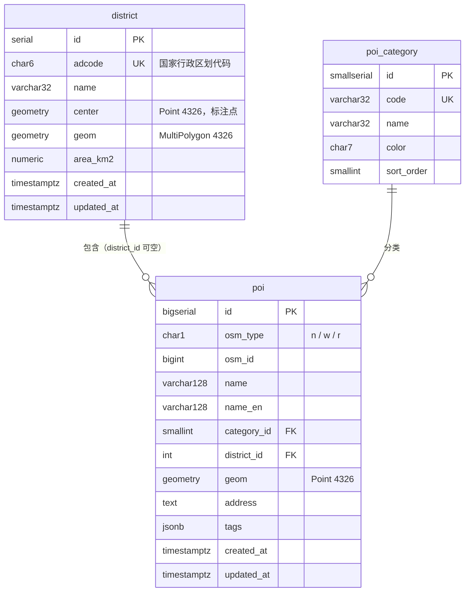
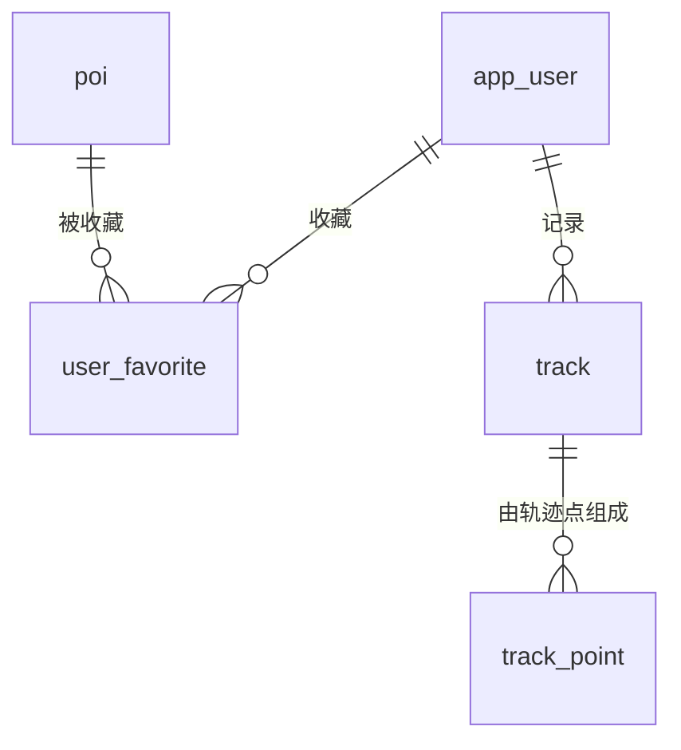

# 数据库设计：北京地图 Demo（beijing-geo-map）

> 本文给出完整的表结构、索引、典型查询和设计取舍。系统架构见 [02-technical-design.md](02-technical-design.md)。

## 1. 概述

| 项 | 约定 |
|---|---|
| 数据库 | PostgreSQL 16 + PostGIS 3.4（镜像 `postgis/postgis:16-3.4`） |
| 扩展 | `postgis`：空间类型、空间函数和空间索引；`pg_trgm`：三元组模糊搜索 |
| 坐标系 | 所有几何字段统一使用 SRID 4326（WGS-84 经纬度），不在库中存储任何 GCJ-02 坐标 |
| 编码与区域设置 | 使用官方镜像默认的 `UTF8` 编码和 `en_US.utf8` 区域设置。`pg_trgm` 依赖区域设置来判断哪些字符算作「字母或数字」，在这个设置下中文字符能正确生成三元组。集成测试会验证这一点 |
| 命名 | 表名和列名使用小写蛇形命名，表名用单数；索引命名为 `表_列_类型`，例如 `poi_geom_gist` |
| 时间 | 统一使用 `timestamptz`。`updated_at` 由 upsert 语句显式写入 `now()`，不使用触发器 |
| 迁移 | 使用 golang-migrate，每个版本都有 `up` 和 `down` 两个脚本 |

## 2. ER 图



## 3. 表结构

### 3.1 `district`：行政区

```sql
CREATE TABLE district (
    id          serial PRIMARY KEY,
    adcode      char(6)        NOT NULL,
    name        varchar(32)    NOT NULL,
    center      geometry(Point, 4326)        NOT NULL,
    geom        geometry(MultiPolygon, 4326) NOT NULL,
    area_km2    numeric(10, 2) NOT NULL CHECK (area_km2 > 0),
    created_at  timestamptz    NOT NULL DEFAULT now(),
    updated_at  timestamptz    NOT NULL DEFAULT now(),
    CONSTRAINT district_adcode_uk   UNIQUE (adcode),
    CONSTRAINT district_adcode_fmt  CHECK (adcode ~ '^[0-9]{6}$'),
    CONSTRAINT district_geom_valid  CHECK (ST_IsValid(geom))
);

CREATE INDEX district_geom_gist ON district USING gist (geom);
```

| 列 | 说明 |
|---|---|
| `adcode` | 国家标准行政区划代码，例如 `110108` 表示海淀区。它是业务主键，接口路径也用它 |
| `center` | 区名标注点，用 `ST_PointOnSurface(geom)` 计算，保证落在面内。不直接用几何中心，因为形状不规则的区，几何中心可能落在区外 |
| `geom` | 导入时已从 GCJ-02 转换为 WGS-84，经过 `ST_MakeValid` 修复，并统一为 MultiPolygon |
| `area_km2` | 用 `ST_Area(geom::geography) / 1e6` 计算，是椭球面上的真实面积，单位平方千米 |

`district_geom_valid` 约束是一道保险：坐标转换可能产生自相交等非法几何，而非法几何会让 `ST_Contains` 返回错误结果。导入器会先修复再写入，万一修复失败，这个约束会让整个导入事务回滚，而不是把坏数据悄悄写进库里。

### 3.2 `poi_category`：POI 分类

```sql
CREATE TABLE poi_category (
    id          smallserial PRIMARY KEY,
    code        varchar(32) NOT NULL,
    name        varchar(32) NOT NULL,
    color       char(7)     NOT NULL,
    sort_order  smallint    NOT NULL DEFAULT 0,
    CONSTRAINT poi_category_code_uk    UNIQUE (code),
    CONSTRAINT poi_category_color_fmt  CHECK (color ~ '^#[0-9A-Fa-f]{6}$')
);
```

种子数据（迁移 `000002`）：

| code | name | color | sort_order |
|---|---|---|---|
| `subway_station` | 地铁站 | `#E53935` | 1 |
| `university` | 高校 | `#1E88E5` | 2 |
| `attraction` | 景点/博物馆 | `#FB8C00` | 3 |
| `hospital` | 医院 | `#8E24AA` | 4 |
| `park` | 公园 | `#43A047` | 5 |

### 3.3 `poi`：兴趣点

```sql
CREATE TABLE poi (
    id           bigserial    PRIMARY KEY,
    osm_type     char(1)      NOT NULL,
    osm_id       bigint       NOT NULL,
    name         varchar(128) NOT NULL,
    name_en      varchar(128),
    category_id  smallint     NOT NULL REFERENCES poi_category (id),
    district_id  integer      REFERENCES district (id) ON DELETE SET NULL,
    geom         geometry(Point, 4326) NOT NULL,
    address      text,
    tags         jsonb        NOT NULL DEFAULT '{}'::jsonb,
    created_at   timestamptz  NOT NULL DEFAULT now(),
    updated_at   timestamptz  NOT NULL DEFAULT now(),
    CONSTRAINT poi_osm_uk        UNIQUE (osm_type, osm_id),
    CONSTRAINT poi_osm_type_chk  CHECK (osm_type IN ('n', 'w', 'r')),
    CONSTRAINT poi_name_not_blank CHECK (btrim(name) <> '')
);

CREATE INDEX poi_geom_gist        ON poi USING gist (geom);
CREATE INDEX poi_geog_gist        ON poi USING gist ((geom::geography));
CREATE INDEX poi_name_trgm        ON poi USING gin (name gin_trgm_ops);
CREATE INDEX poi_category_id_idx  ON poi (category_id);
CREATE INDEX poi_district_id_idx  ON poi (district_id);
```

| 列 | 说明 |
|---|---|
| `osm_type` + `osm_id` | 数据在 OSM 中的唯一标识，取值分别为节点（n）、线（w）、关系（r）。用于导入时幂等 upsert，也可以拼出 OSM 原始页面链接 |
| `name` | 优先取 `name:zh`，其次取 `name` |
| `district_id` | 冗余字段，由导入器根据空间关系计算。为空表示 POI 落在边界数据之外 |
| `geom` | 节点直接使用其坐标；线和关系使用 Overpass `out center` 返回的中心点 |
| `tags` | OSM 原始标签，例如开放时间、网站、电话。详情弹窗按需从中取值 |

## 4. 索引设计

每个索引都对应一类具体查询：

| 索引 | 类型 | 支撑的查询 | 对应接口 |
|---|---|---|---|
| `district_geom_gist` | GiST | `ST_Contains(d.geom, point)`：点在面内 | `/districts/locate`、导入时重算 `district_id` |
| `poi_geom_gist` | GiST | `geom && ST_MakeEnvelope(...)`：外包矩形相交 | `/pois?bbox=` |
| `poi_geog_gist` | GiST（表达式） | `ST_DWithin(geom::geography, p, r)`：按米计算的距离过滤 | `/pois/nearby` |
| `poi_name_trgm` | GIN | `name ILIKE '%关键词%'` 和 `similarity()` | `/pois/search` |
| `poi_osm_uk` | B-tree（唯一） | `ON CONFLICT (osm_type, osm_id)` | 导入 |
| `poi_category_id_idx` | B-tree | 按分类筛选和统计 | `/pois`、`/districts/{adcode}` |
| `poi_district_id_idx` | B-tree | 按区统计 | `/districts`、`/districts/{adcode}` |

**注意事项：**

- **表达式索引只有在查询表达式完全一致时才会生效。** 附近查询必须写成 `geom::geography`，和索引定义一字不差。写成 `geography(geom)` 等形式就用不上索引。
- **两个字的中文查询用不上三元组索引。** `pg_trgm` 从模式中提取三个字符的片段，「北大」这类两个字的查询提取不出片段，规划器会选择全表扫描。数据只有约 4000 行时，全表扫描也是毫秒级，可以接受。数据量增大后，可以改用二元组扩展 `pg_bigm`。
- **数据量小时，规划器可能不走索引。** 几千行数据时，PostgreSQL 可能认为全表扫描更便宜。这是正常行为。集成测试中会用 `SET enable_seqscan = off` 配合 `EXPLAIN`，确认索引确实可用。

## 5. 关键设计取舍

### 5.1 用 `geometry` 存储，再加一个 `geography` 表达式索引

| 方案 | 优点 | 缺点 |
|---|---|---|
| 只用 `geometry(4326)` | `ST_Contains` 等平面运算快，可用的函数最全 | 距离单位是「度」，北京地区 1 度经度约 85 千米、1 度纬度约 111 千米，无法直接按米查询 |
| 只用 `geography` | 距离和面积按米计算，结果精确 | 部分函数不支持；`ST_Contains` 需要先转回 geometry |
| **`geometry` 存储 + `geography` 表达式索引（采用）** | 两种能力都有：点在面内用 geometry，按距离查询用 geography，并且都能使用索引 | 多一个索引的存储和写入开销，在本项目的数据量下可以忽略 |

### 5.2 `poi.district_id` 冗余存储

- **好处**：「海淀区有多少高校」只需要一个 `GROUP BY`，不用每次请求都做 4000 个点与 16 个多边形的空间关联。区列表接口要同时返回 16 个区的 POI 数量，这个好处尤为明显。
- **代价**：边界或 POI 发生变化后必须重算。导入器在每次导入的最后一步统一重算，并且和其他导入步骤处于同一个事务中，因此不会出现不一致的中间状态。
- **允许为空**：DataV 边界和 OSM 数据的边界并不完全一致，靠近市界的少量 POI 可能匹配不到任何区。外键设置为 `ON DELETE SET NULL`。

### 5.3 分类单独建表，而不是用枚举或字符串

- 新增分类只需要插入一行，不用 `ALTER TYPE`。
- 颜色、排序等展示属性和分类放在一起，前端通过 `/poi-categories` 接口获取，不需要在前端写死。
- `poi` 表只存 2 字节的 `smallint` 外键，满足第三范式。

### 5.4 OSM 原始标签放进 `jsonb`

OSM 的标签种类非常多，例如开放时间、网站、电话、门票、wiki 链接。如果每种都建一列，表结构会严重膨胀，而且大部分列都是空值。高频使用、结构稳定的字段（`name`、`name_en`、`address`）提升为独立列，其余标签保留在 `tags` 中，以便追溯和按需展示。第一版不对 `tags` 建索引，因为没有按标签筛选的需求。

### 5.5 用 OSM 标识作为幂等导入的依据

`UNIQUE (osm_type, osm_id)` 让导入器可以安全地重复执行，并配合快照同步删除已经消失的 POI。自增的 `id` 依然是内部主键和接口中使用的 ID。这样即使将来更换数据源，接口中的 ID 也不会受影响。

## 6. 典型查询

以下是每个接口对应的核心 SQL。`$n` 表示参数占位符。

### 6.1 区列表（`/districts`）

```sql
SELECT d.adcode,
       d.name,
       d.area_km2,
       ST_AsGeoJSON(d.center, 6)                                  AS center,
       ST_AsGeoJSON(ST_Multi(ST_SimplifyPreserveTopology(d.geom, 0.0001)), 6) AS geometry,
       COUNT(p.id)                                                AS poi_count
FROM district d
LEFT JOIN poi p ON p.district_id = d.id
GROUP BY d.id
ORDER BY d.adcode;
```

`ST_SimplifyPreserveTopology` 是逐个要素独立简化的，相邻两个区的公共边界简化后可能出现极细的缝隙。容差为 0.0001 度（约 10 米）时，城市尺度下肉眼看不出来。外面再套一层 `ST_Multi`：只含一个多边形的 MultiPolygon 简化后会变成 Polygon，套上之后返回的几何类型始终是 MultiPolygon。

### 6.2 区详情（`/districts/{adcode}`）

```sql
-- 基本信息
SELECT id, adcode, name, area_km2, ST_AsGeoJSON(center, 6) AS center
FROM district WHERE adcode = $1;

-- 各分类数量（用 LEFT JOIN 保证数量为 0 的分类也会返回）
-- $1 = 上一条查询得到的 district.id
SELECT c.code, c.name, COUNT(p.id) AS count
FROM poi_category c
LEFT JOIN poi p ON p.category_id = c.id AND p.district_id = $1
GROUP BY c.id
ORDER BY c.sort_order;
```

### 6.3 我在哪个区（`/districts/locate`）

```sql
SELECT adcode, name
FROM district
WHERE ST_Contains(geom, ST_SetSRID(ST_MakePoint($1, $2), 4326))
LIMIT 1;
```

`ST_MakePoint` 的参数顺序是先经度、后纬度，和 GeoJSON 一致。

### 6.4 视野范围内的 POI（`/pois`）

```sql
SELECT p.id, p.name, c.code AS category, ST_AsGeoJSON(p.geom, 6) AS geometry
FROM poi p
JOIN poi_category c ON c.id = p.category_id
WHERE p.geom && ST_MakeEnvelope($1, $2, $3, $4, 4326)
  AND ($5::smallint[] IS NULL OR p.category_id = ANY($5))
ORDER BY p.id
LIMIT $6 + 1;
```

查询时多取 1 条：如果实际返回了 `limit + 1` 条，说明结果被截断了，丢掉最后一条后设置 `truncated: true`。这比额外执行一次 `COUNT(*)` 更省。

### 6.5 POI 详情（`/pois/{id}`）

```sql
SELECT p.id, p.name, p.name_en, p.osm_type, p.osm_id, p.address, p.tags,
       c.code, c.name AS category_name, c.color,
       d.adcode, d.name AS district_name,
       ST_X(p.geom) AS lng, ST_Y(p.geom) AS lat
FROM poi p
JOIN poi_category c ON c.id = p.category_id
LEFT JOIN district d ON d.id = p.district_id
WHERE p.id = $1;
```

### 6.6 搜索（`/pois/search`）

```sql
-- $1 = '%' || 转义后的关键词 || '%'，$2 = 原始关键词，$3 = limit
SELECT p.id, p.name, c.code AS category, d.name AS district_name,
       ST_X(p.geom) AS lng, ST_Y(p.geom) AS lat
FROM poi p
JOIN poi_category c ON c.id = p.category_id
LEFT JOIN district d ON d.id = p.district_id
WHERE p.name ILIKE $1
ORDER BY (p.name = $2) DESC,
         similarity(p.name, $2) DESC,
         length(p.name),
         p.id
LIMIT $3;
```

PostgreSQL 中 `LIKE` / `ILIKE` 的默认转义字符是反斜杠。Go 代码会依次把关键词中的 `\`、`%`、`_` 替换成 `\\`、`\%`、`\_`。

### 6.7 附近查询（`/pois/nearby`）

```sql
-- $1 = lng, $2 = lat, $3 = 半径（米）, $4 = 分类 ID 数组或 NULL, $5 = limit
WITH origin AS (
    SELECT ST_SetSRID(ST_MakePoint($1, $2), 4326)::geography AS g
)
SELECT p.id, p.name, c.code AS category,
       ST_AsGeoJSON(p.geom, 6)                    AS geometry,
       round(ST_Distance(p.geom::geography, o.g)) AS distance_m
FROM poi p
JOIN poi_category c ON c.id = p.category_id
CROSS JOIN origin o
WHERE ST_DWithin(p.geom::geography, o.g, $3)
  AND ($4::smallint[] IS NULL OR p.category_id = ANY($4))
ORDER BY distance_m, p.id
LIMIT $5;
```

`ST_DWithin` 会先用 `poi_geog_gist` 索引按外包框过滤，再计算精确距离。这里不用 `ST_Distance(...) < r` 作为过滤条件，因为那种写法无法使用索引。

## 7. 导入相关 SQL

### 7.1 行政区 upsert

```sql
-- $1 = adcode, $2 = name, $3 = 已在 Go 中转换为 WGS-84 的几何 GeoJSON 字符串
WITH src AS (
    SELECT ST_Multi(ST_CollectionExtract(
               ST_MakeValid(ST_SetSRID(ST_GeomFromGeoJSON($3), 4326)), 3)) AS g
)
INSERT INTO district (adcode, name, center, geom, area_km2)
SELECT $1, $2, ST_PointOnSurface(g), g, round((ST_Area(g::geography) / 1e6)::numeric, 2)
FROM src
ON CONFLICT (adcode) DO UPDATE
SET name       = EXCLUDED.name,
    center     = EXCLUDED.center,
    geom       = EXCLUDED.geom,
    area_km2   = EXCLUDED.area_km2,
    updated_at = now();
```

`ST_CollectionExtract(..., 3)` 只保留面类型的几何。`ST_MakeValid` 修复自相交时可能产生线或点等副产物，这一步会把它们过滤掉。

### 7.2 POI upsert

```sql
INSERT INTO poi (osm_type, osm_id, name, name_en, category_id, geom, address, tags)
VALUES ($1, $2, $3, $4, $5, ST_SetSRID(ST_MakePoint($6, $7), 4326), $8, $9)
ON CONFLICT (osm_type, osm_id) DO UPDATE
SET name        = EXCLUDED.name,
    name_en     = EXCLUDED.name_en,
    category_id = EXCLUDED.category_id,
    geom        = EXCLUDED.geom,
    address     = EXCLUDED.address,
    tags        = EXCLUDED.tags,
    updated_at  = now();
```

导入器使用 pgx 的 `Batch` 批量提交，以减少网络往返。

### 7.3 快照同步删除

快照文件损坏或为空时，这一步会删光整张 `poi` 表。因此导入器会在执行删除前检查：如果快照解析出的 POI 少于 1000 条，就直接报错退出，整个事务回滚。正常快照约有 4000 条。

```sql
CREATE TEMP TABLE snapshot_keys (osm_type char(1), osm_id bigint) ON COMMIT DROP;
-- 用 COPY 把本次快照中所有 POI 的 (osm_type, osm_id) 写入临时表
DELETE FROM poi p
WHERE NOT EXISTS (
    SELECT 1 FROM snapshot_keys k
    WHERE k.osm_type = p.osm_type AND k.osm_id = p.osm_id
);
```

### 7.4 重算 `district_id`

```sql
-- 一条语句同时完成分配和清空：不在任何区内的 POI 得到 NULL。
-- 多个区都包含同一个点时取 adcode 最小的区，保证重复导入的结果稳定。
UPDATE poi p
SET district_id = m.district_id, updated_at = now()
FROM (
    SELECT p2.id AS poi_id,
           (SELECT d.id FROM district d WHERE ST_Contains(d.geom, p2.geom) ORDER BY d.adcode LIMIT 1) AS district_id
    FROM poi p2
) m
WHERE m.poi_id = p.id
  AND p.district_id IS DISTINCT FROM m.district_id;
```

## 8. 迁移文件

| 版本 | 文件 | up 做什么 | down 做什么 |
|---|---|---|---|
| 000001 | `000001_init` | 创建 `postgis` 和 `pg_trgm` 扩展，创建三张表和所有索引 | 按依赖倒序删除三张表（扩展保留，避免影响库中的其他对象） |
| 000002 | `000002_seed_poi_categories` | 插入 5 条分类数据 | 删除这 5 条分类数据 |

迁移文件通过 `embed.FS` 打包进 `importer` 二进制。golang-migrate 在库中维护 `schema_migrations` 表来记录当前版本。

## 9. 后续扩展的表设计（第一版不建）



```sql
CREATE TABLE app_user (
    id             bigserial   PRIMARY KEY,
    username       varchar(32) NOT NULL UNIQUE,
    password_hash  text        NOT NULL,          -- bcrypt
    created_at     timestamptz NOT NULL DEFAULT now()
);

CREATE TABLE user_favorite (
    user_id     bigint       NOT NULL REFERENCES app_user (id) ON DELETE CASCADE,
    poi_id      bigint       NOT NULL REFERENCES poi (id) ON DELETE CASCADE,
    note        varchar(200),
    created_at  timestamptz  NOT NULL DEFAULT now(),
    PRIMARY KEY (user_id, poi_id)
);

CREATE TABLE track (
    id          bigserial   PRIMARY KEY,
    user_id     bigint      NOT NULL REFERENCES app_user (id) ON DELETE CASCADE,
    name        varchar(64) NOT NULL,
    started_at  timestamptz NOT NULL,
    ended_at    timestamptz,
    path        geometry(LineString, 4326),       -- 结束时由轨迹点 ST_MakeLine 生成
    length_m    numeric(12, 1)
);

CREATE TABLE track_point (
    track_id     bigint      NOT NULL REFERENCES track (id) ON DELETE CASCADE,
    seq          integer     NOT NULL,
    geom         geometry(Point, 4326) NOT NULL,
    recorded_at  timestamptz NOT NULL,
    accuracy_m   real,
    PRIMARY KEY (track_id, seq)
);
CREATE INDEX track_path_gist ON track USING gist (path);
```

如果将来允许用户自己创建 POI，需要给 `poi` 表增加 `source` 列（取值 `osm` 或 `user`）和 `created_by` 列，并把 `osm_type` / `osm_id` 改为可空，唯一约束改为部分唯一索引：`UNIQUE (osm_type, osm_id) WHERE source = 'osm'`。这些改动都可以通过一个新的迁移完成，不影响现有接口。

## 10. 本地查看数据

```bash
# 进入数据库
docker compose exec db psql -U geo -d geo

# 常用检查
SELECT count(*) FROM district;                          -- 期望 16
SELECT c.name, count(*) FROM poi p JOIN poi_category c ON c.id = p.category_id GROUP BY c.name;
SELECT round(100.0 * count(district_id) / count(*), 1) AS district_fill_pct FROM poi;
SELECT show_trgm('北京大学');                            -- 期望返回非空数组
EXPLAIN ANALYZE SELECT name FROM poi WHERE ST_DWithin(geom::geography, ST_MakePoint(116.397, 39.908)::geography, 1000);
```
