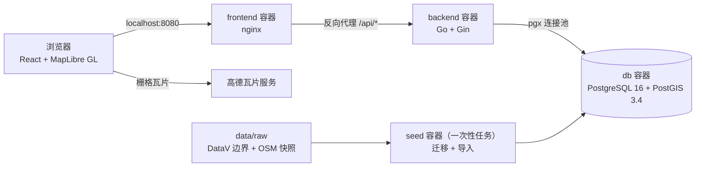

# 阶段 5：打磨与交付 Implementation Plan

> **For agentic workers:** REQUIRED SUB-SKILL: Use superpowers:subagent-driven-development (recommended) or superpowers:executing-plans to implement this plan task-by-task. Steps use checkbox (`- [ ]`) syntax for tracking.

**Goal:** 完善加载中、空结果和出错时的界面提示，清理代码和配置，补全 README（截图、一键启动、架构图、数据署名、CI 徽章），使 clone 仓库后执行 `docker compose up --build` 就能完整使用。

**Architecture:** 不改变前四个阶段的结构。接口错误在 `api/client.ts` 里分类成带 `code` 的 `ApiError`，仍由 `QueryCache.onError` 统一写入 store；store 的提示可以带一个重试动作，提示条据此显示「重试」按钮。页面级错误由最外层的 React 错误边界接住。可以单测的逻辑放在 `api/client.ts`、`lib/fatalError.ts`、store 和 `map/layers.ts`；依赖 DOM 和 WebGL 的组件靠 lint、类型检查、构建和阶段结束时的浏览器验收保证。后端只收紧「客户端取消记 499」的判断。

**Tech Stack:** React 19.3、TypeScript ~6.0.3、Vite 8.3、Vitest 5、Tailwind CSS 4.3、maplibre-gl 6.14、@tanstack/react-query 5.104、zustand 5.0；Go 1.26、Gin；nginx 1.29。

**Spec:** `docs/01-implementation-plan.md`（第 5 节「阶段 5」）、`docs/02-technical-design.md`（第 3.2、6、7、9、10 节）

## Global Constraints

- 所有工作在 `phase-5-polish` 分支上进行，每个任务结束时提交一次。git 提交身份已经配置好，不要修改；环境会在提交信息末尾自动加一行 `Co-authored-by: Cursor`。
- 不新增任何依赖（前端和后端都不加）。TypeScript 保持 `~6.0.3`。
- MapLibre 6 只能用命名导入，类型用 `import type`。地图事件回调用 `map.on(...)` 返回的订阅对象的 `unsubscribe()` 注销。
- 坐标系：接口数据、store、查询参数一律是 WGS-84，只能通过 `src/config.ts` 导出的 `toDisplay()` / `toData()` 转换。本计划不改任何坐标转换逻辑。
- 前端检查命令：`cd frontend && npm run lint && npm run typecheck && npm test && npm run build`，输出中不能有错误或警告（`npm warn Unknown env config "devdir"` 来自本机 npm 配置，可以忽略）。Vitest 运行在 node 环境，只测纯函数、store 和查询选项。项目不使用 Prettier，不要运行它。
- 后端检查命令：`cd backend && gofmt -l . && go vet ./... && go test ./...`，`gofmt -l` 不能输出任何文件。本机 Go 1.21 会按 `go.mod` 自动切换到 1.26 工具链。
- 计划中的代码已经在一份原型里通过上面全部检查，并在浏览器中验证过（后端停止时的提示和重试、慢网络下的加载提示、WebGL 不可用时的错误页、底图地址不可用时的提示、nginx 响应头）；照抄即可，不要自行“改进”。如果检查失败，先确认代码与计划一致，再报告问题。
- 界面文案和提示使用中文。代码注释只用来说明代码本身体现不出来的约束。
- 本地环境：compose 的 `db` 服务在运行（`127.0.0.1:5432`，已导入完整数据）。8080 端口被占用，启动整套服务时使用 `FRONTEND_PORT=18080`。验证完执行 `docker compose stop frontend backend`，保留 db。绝不执行 `docker compose down -v`。
- **沙箱说明：** docker、curl、`go test`（首次可能要下载工具链）以及 git commit 命令都需要 Shell `required_permissions: ["all"]`；`npm` 命令被沙箱拦截时同样用 `["all"]`。临时文件放在仓库内被 git 忽略的 `.superpowers/` 目录下，不要放 `/tmp`。

### 本计划的决定

以下内容在规格中没有写明，由本计划决定：

1. **错误分类。** 502、503、504 且响应体不是标准错误格式（nginx 连不上后端时返回自己的 HTML 错误页）记为 `BACKEND_UNAVAILABLE`，提示「后端服务未启动或暂时不可用」。成功响应的 `Content-Type` 不是 `application/json` 或以 `+json` 结尾（三个 GeoJSON 接口返回 `application/geo+json`），或者 JSON 解析失败，记为 `BAD_RESPONSE`，提示「服务器返回了无法识别的内容」。其余规则不变。
2. **重试。** `isRetryable(error)`：4xx 以外的错误都值得重试，`shouldRetry` 改为基于它。值得重试的查询错误在提示条上带「重试」按钮，点击后关闭提示并重新请求所有当前在用（`type: 'active'`）且出错的查询；区边界和分类的 `staleTime` 是 `Infinity`，没有这个按钮就只能刷新页面。区详情面板和附近面板加载失败时，面板里也有「重试」按钮。POI 详情失败时弹窗本来就不打开，不加按钮，再点一次即可。
3. **加载中提示。** POI 请求超过 400 毫秒还没有返回时，在顶部中间显示「正在加载 POI…」，与「当前范围数据过多，请放大地图」共用一个始终挂载的 `role="status"` 元素（读屏软件只朗读已存在的 live region 的变化）。搜索框在防抖等待期间也显示「搜索中…」，不再显示上一个词的「没有找到相关地点」。区边界和分类只在首次加载时请求一次，很快，不加提示。
4. **页面级错误边界。** 最外层包一个 `ErrorBoundary`，显示「地图无法显示」、`describeFatalError()` 给出的说明、原始错误信息和「刷新页面」按钮。MapLibre 创建不了 WebGL 上下文时抛出的错误信息带「WebGL」，说明文字提示开启硬件加速或换浏览器。
5. **底图。** 底图瓦片加载失败（`error` 事件且 `sourceId` 为底图数据源）时提示一次「底图加载失败…」，不带重试。底图署名可以用构建变量 `VITE_TILE_ATTRIBUTION` 配置，默认「底图 © 高德地图」。`VITE_TILE_CRS` 在 `vite.config.ts` 中校验，写错时构建直接失败；为此 `TileCrs` 类型从 `lib/coord.ts` 挪到 `lib/tiles.ts`，使 `tiles.ts` 不依赖其他文件，`vite.config.ts` 用带扩展名的路径引入它（Vite 的新配置加载器要求写扩展名，否则构建输出警告）。
6. **nginx。** 开启 `gzip_vary`，只压缩 1 KB 以上的响应；`index.html` 设为 `no-cache`；`/assets/` 只发一条 `Cache-Control: public, max-age=31536000, immutable`（原来的 `expires 1y` 会再加一条）；`resolver_timeout 5s`。
7. **后端。** 只有请求上下文的错误是 `context.Canceled`（客户端断开）时才记为 499；请求超时（`DeadlineExceeded`）即使 service 返回的是 `context.Canceled`，也按内部错误返回 500 并记录错误日志。
8. **交互细节。** 地图开始移动时隐藏区悬停提示（否则飞到别处后提示停在原来的坐标）；按着鼠标拖动时不把光标改成手型。分类色块抽成 `CategoryDot` 组件，五处共用。Tailwind 不扫描测试文件。
9. **README。** 头图和功能截图复用阶段 3、4 的验收截图；架构图与技术方案第 1 节相同；新增「更换底图」和「常见问题」两节，状态改为「第一版已完成」。
10. **本阶段不做：** 按分类开关在前端即时过滤 POI；平移失败时保留旧 POI；把 maplibre 拆成单独的包；附近面板打开时关闭区的悬停高亮；nginx 错误日志中的定位参数（只在后端不可用时出现）；面板外框样式去重；POI 弹窗在详情加载期间的提示。

---

### Task 1: 后端：只有客户端取消才记 499

**Files:**
- Modify: `backend/internal/handler/response.go`
- Modify: `backend/internal/handler/poi_test.go`

- [ ] **Step 1: 编写测试**

在 `backend/internal/handler/poi_test.go` 的 import 列表中，`"testing"` 之后加一行 `"time"`：

```go
import (
	"context"
	"net/http"
	"net/http/httptest"
	"net/url"
	"slices"
	"strings"
	"testing"
	"time"

	"github.com/slatt-oo/beijing-geo-map/backend/internal/model"
	"github.com/slatt-oo/beijing-geo-map/backend/internal/service"
)
```

在 `TestClientCanceledRequestsAreNotLoggedAsErrors` 末尾、ERROR 断言之后，追加对访问日志状态码的断言；并在这个函数之后新增 `TestRequestDeadlinesAreInternalErrors`。替换后这两个函数完整如下：

```go
func TestClientCanceledRequestsAreNotLoggedAsErrors(t *testing.T) {
	logs := captureLogs(t)
	r := newTestRouter(&fakeDistrictService{}, &fakePOIService{err: context.Canceled})
	ctx, cancel := context.WithCancel(context.Background())
	cancel()
	rec := httptest.NewRecorder()

	r.ServeHTTP(rec, httptest.NewRequest(http.MethodGet, "/api/v1/pois/42", nil).WithContext(ctx))

	if rec.Code != statusClientClosedRequest {
		t.Fatalf("status = %d, want %d", rec.Code, statusClientClosedRequest)
	}
	if strings.Contains(logs.String(), `"level":"ERROR"`) {
		t.Fatalf("a client cancellation must not be logged as an error:\n%s", logs)
	}
	if !strings.Contains(logs.String(), `"status":499`) {
		t.Fatalf("the access log must record the cancellation as 499:\n%s", logs)
	}
}

func TestRequestDeadlinesAreInternalErrors(t *testing.T) {
	for _, serviceErr := range []error{context.DeadlineExceeded, context.Canceled} {
		t.Run(serviceErr.Error(), func(t *testing.T) {
			logs := captureLogs(t)
			r := newTestRouter(&fakeDistrictService{}, &fakePOIService{err: serviceErr})
			ctx, cancel := context.WithDeadline(context.Background(), time.Now().Add(-time.Second))
			defer cancel()
			rec := httptest.NewRecorder()

			r.ServeHTTP(rec, httptest.NewRequest(http.MethodGet, "/api/v1/pois/42", nil).WithContext(ctx))

			assertErrorResponse(t, rec, http.StatusInternalServerError, CodeInternal, "服务器内部错误")
			if !strings.Contains(logs.String(), `"level":"ERROR"`) {
				t.Fatalf("a request that ran out of time must be logged as an error:\n%s", logs)
			}
		})
	}
}
```

- [ ] **Step 2: 运行测试，确认失败**

```bash
cd backend && go test -count=1 ./internal/handler/ -run 'Deadline|Cancel' -v
```

预期：`TestRequestDeadlinesAreInternalErrors/context_canceled` 失败（现在超时的请求只要 service 返回 `context.Canceled` 就被记为 499），其余通过。

- [ ] **Step 3: 实现**

`backend/internal/handler/response.go` 的 `writeServiceError` 中，把

```go
	case errors.Is(err, context.Canceled) && c.Request.Context().Err() != nil:
```

替换为

```go
	// 只看 Canceled：请求超时（DeadlineExceeded）是服务端的问题，要按内部错误记录。
	case errors.Is(err, context.Canceled) && errors.Is(c.Request.Context().Err(), context.Canceled):
```

- [ ] **Step 4: 运行后端检查**

```bash
cd backend && gofmt -l . && go vet ./... && go test ./...
```

预期：`gofmt -l` 无输出，全部测试通过。

- [ ] **Step 5: 提交**

```bash
git add backend/internal/handler/response.go backend/internal/handler/poi_test.go
git commit -m "fix(backend): log only client cancellations as 499"
```

---

### Task 2: 前端：接口错误、重试和页面级错误边界

**Files:**
- Modify: `frontend/src/api/client.ts`、`frontend/src/api/client.test.ts`
- Modify: `frontend/src/store/useAppStore.ts`、`frontend/src/store/useAppStore.test.ts`
- Modify: `frontend/src/components/NoticeBanner.tsx`
- Modify: `frontend/src/main.tsx`
- Create: `frontend/src/components/ErrorBoundary.tsx`
- Create: `frontend/src/lib/fatalError.ts`、`frontend/src/lib/fatalError.test.ts`
- Modify: `frontend/src/components/DistrictPanel.tsx`、`frontend/src/components/NearbyPanel.tsx`（面板里的「重试」）
- Modify: `frontend/src/map/PoiPopup.tsx`

**Interfaces:**
- Produces: `isRetryable(error: unknown): boolean`（`api/client.ts`）；`Notice` 新增可选字段 `retry?: () => void`，`showError(message: string, retry?: () => void)`；`describeFatalError(error: unknown): string`；`ErrorBoundary` 组件。Task 3 会再次整体替换 `DistrictPanel.tsx` 和 `NearbyPanel.tsx`。

- [ ] **Step 1: 编写测试**

`frontend/src/api/client.test.ts`（整个文件替换）：

```ts
import { afterEach, describe, expect, it, vi } from 'vitest'
import { ApiError, apiGet, apiGetData, buildUrl, errorMessage, isRetryable, shouldRetry } from './client'

function jsonResponse(status: number, body: unknown): Response {
  return new Response(JSON.stringify(body), {
    status,
    headers: { 'Content-Type': 'application/json' },
  })
}

describe('buildUrl', () => {
  it('returns the bare path under /api/v1 when there are no params', () => {
    expect(buildUrl('/health')).toBe('/api/v1/health')
  })

  it('encodes params and skips null, undefined and empty arrays', () => {
    const url = buildUrl('/pois/search', { q: '北京', limit: 10, categories: [], radius: undefined, lng: null })
    expect(url).toBe('/api/v1/pois/search?q=%E5%8C%97%E4%BA%AC&limit=10')
  })

  it('joins array params with commas', () => {
    expect(buildUrl('/pois', { categories: ['park', 'university'] })).toBe(
      '/api/v1/pois?categories=park%2Cuniversity',
    )
  })
})

describe('apiGet', () => {
  afterEach(() => {
    vi.unstubAllGlobals()
  })

  it('requests the built URL and returns the parsed body', async () => {
    const fetchMock = vi.fn<typeof fetch>(async () => jsonResponse(200, { data: { status: 'ok', db: 'ok' } }))
    vi.stubGlobal('fetch', fetchMock)
    const controller = new AbortController()

    await expect(apiGet('/health', { verbose: 1 }, controller.signal)).resolves.toEqual({
      data: { status: 'ok', db: 'ok' },
    })
    expect(fetchMock).toHaveBeenCalledWith(
      '/api/v1/health?verbose=1',
      expect.objectContaining({ signal: controller.signal }),
    )
  })

  it('throws ApiError carrying the server error code and message', async () => {
    vi.stubGlobal(
      'fetch',
      vi.fn(async () => jsonResponse(400, { error: { code: 'INVALID_PARAM', message: 'lat 必须在 -90 到 90 之间' } })),
    )

    const err = await apiGet('/districts/locate').catch((e: unknown) => e)

    expect(err).toBeInstanceOf(ApiError)
    expect(err).toMatchObject({ status: 400, code: 'INVALID_PARAM', message: 'lat 必须在 -90 到 90 之间' })
  })

  it('falls back to HTTP_ERROR when the error body is not the standard format', async () => {
    vi.stubGlobal('fetch', vi.fn(async () => new Response('<html>Internal Server Error</html>', { status: 500 })))

    await expect(apiGet('/health')).rejects.toMatchObject({ status: 500, code: 'HTTP_ERROR' })
  })

  it.each([502, 503, 504])('reports an unreachable backend for an HTML %i from nginx', async (status) => {
    vi.stubGlobal('fetch', vi.fn(async () => new Response('<html>Bad Gateway</html>', { status })))

    await expect(apiGet('/health')).rejects.toMatchObject({
      status,
      code: 'BACKEND_UNAVAILABLE',
      message: '后端服务未启动或暂时不可用',
    })
  })

  it('accepts GeoJSON responses', async () => {
    const body = { type: 'FeatureCollection', features: [] }
    vi.stubGlobal(
      'fetch',
      vi.fn(
        async () =>
          new Response(JSON.stringify(body), { status: 200, headers: { 'Content-Type': 'application/geo+json' } }),
      ),
    )

    await expect(apiGet('/districts')).resolves.toEqual(body)
  })

  it('rejects a successful response that is not JSON', async () => {
    vi.stubGlobal(
      'fetch',
      vi.fn(async () => new Response('<!doctype html><title>北京地图 Demo</title>', { status: 200 })),
    )

    await expect(apiGet('/health')).rejects.toMatchObject({ status: 200, code: 'BAD_RESPONSE' })
  })

  it('rejects a JSON content type whose body does not parse', async () => {
    vi.stubGlobal(
      'fetch',
      vi.fn(async () => new Response('{"data":', { status: 200, headers: { 'Content-Type': 'application/json' } })),
    )

    await expect(apiGet('/health')).rejects.toMatchObject({ status: 200, code: 'BAD_RESPONSE' })
  })

  it('maps network failures to a NETWORK ApiError', async () => {
    vi.stubGlobal(
      'fetch',
      vi.fn(async () => {
        throw new TypeError('fetch failed')
      }),
    )

    await expect(apiGet('/health')).rejects.toMatchObject({ status: 0, code: 'NETWORK' })
  })

  function signalAwareFetch() {
    return vi.fn<typeof fetch>(async (_input, init) => {
      init?.signal?.throwIfAborted()
      return jsonResponse(200, { data: null })
    })
  }

  it('rethrows a plain abort unchanged', async () => {
    vi.stubGlobal('fetch', signalAwareFetch())
    const controller = new AbortController()
    controller.abort()

    await expect(apiGet('/health', undefined, controller.signal)).rejects.toMatchObject({ name: 'AbortError' })
  })

  it('rethrows an abort with a custom reason unchanged', async () => {
    vi.stubGlobal('fetch', signalAwareFetch())
    const controller = new AbortController()
    const reason = new Error('navigated away')
    controller.abort(reason)

    await expect(apiGet('/health', undefined, controller.signal)).rejects.toBe(reason)
  })

  it('rethrows an abort that happens while reading an error body', async () => {
    const controller = new AbortController()
    const reason = new Error('navigated away')
    vi.stubGlobal(
      'fetch',
      vi.fn<typeof fetch>(async () => {
        controller.abort(reason)
        return jsonResponse(500, { error: { code: 'INTERNAL', message: '服务器内部错误' } })
      }),
    )

    await expect(apiGet('/health', undefined, controller.signal)).rejects.toBe(reason)
  })
})

describe('errorMessage', () => {
  it('uses the server message of an ApiError', () => {
    expect(errorMessage(new ApiError(404, 'NOT_FOUND', 'POI 不存在'))).toBe('POI 不存在')
  })

  it('falls back to a generic message for anything else', () => {
    expect(errorMessage(new TypeError('boom'))).toBe('请求失败，请稍后重试')
  })
})

describe('isRetryable', () => {
  it('treats network, server and unrecognised responses as worth retrying', () => {
    expect(isRetryable(new ApiError(0, 'NETWORK', '网络错误'))).toBe(true)
    expect(isRetryable(new ApiError(502, 'BACKEND_UNAVAILABLE', '后端服务未启动'))).toBe(true)
    expect(isRetryable(new ApiError(200, 'BAD_RESPONSE', '无法识别'))).toBe(true)
    expect(isRetryable(new TypeError('boom'))).toBe(true)
  })

  it('does not retry client errors', () => {
    expect(isRetryable(new ApiError(400, 'INVALID_PARAM', 'bbox 格式错误'))).toBe(false)
    expect(isRetryable(new ApiError(404, 'NOT_FOUND', 'POI 不存在'))).toBe(false)
  })
})

describe('shouldRetry', () => {
  it('retries a network or server error once', () => {
    expect(shouldRetry(0, new ApiError(0, 'NETWORK', '网络错误'))).toBe(true)
    expect(shouldRetry(0, new ApiError(500, 'INTERNAL', '服务器内部错误'))).toBe(true)
    expect(shouldRetry(1, new ApiError(500, 'INTERNAL', '服务器内部错误'))).toBe(false)
  })

  it('does not retry client errors', () => {
    expect(shouldRetry(0, new ApiError(400, 'INVALID_PARAM', 'bbox 格式错误'))).toBe(false)
    expect(shouldRetry(0, new ApiError(404, 'NOT_FOUND', 'POI 不存在'))).toBe(false)
  })
})

describe('apiGetData', () => {
  afterEach(() => {
    vi.unstubAllGlobals()
  })

  it('unwraps the data envelope', async () => {
    vi.stubGlobal('fetch', vi.fn(async () => jsonResponse(200, { data: { adcode: '110108', name: '海淀区' } })))

    await expect(apiGetData('/districts/locate', { lng: 116.3, lat: 39.99 })).resolves.toEqual({
      adcode: '110108',
      name: '海淀区',
    })
  })

  it('keeps a null result, which some endpoints use for "not found here"', async () => {
    vi.stubGlobal('fetch', vi.fn(async () => jsonResponse(200, { data: null })))

    await expect(apiGetData('/districts/locate', { lng: 116.7, lat: 39.5 })).resolves.toBeNull()
  })
})
```

`frontend/src/store/useAppStore.test.ts`：在用例 `shows info and error notices and dismisses them` 之后插入：

```ts
  it('keeps the retry action of an error notice', () => {
    const retry = () => {}
    state().showError('后端服务未启动或暂时不可用', retry)

    expect(state().notice).toEqual({ tone: 'error', message: '后端服务未启动或暂时不可用', retry })
    expect(state().notice?.retry).toBe(retry)
  })
```

`frontend/src/lib/fatalError.test.ts`：

```ts
import { describe, expect, it } from 'vitest'
import { describeFatalError } from './fatalError'

describe('describeFatalError', () => {
  it('explains a missing WebGL context', () => {
    expect(describeFatalError(
        new Error(
          'WebGL2 is required to display this map. We are sorry, but it seems that your browser does not support WebGL2, a technology for rendering 3D graphics on the web.',
        ),
      )).toBe(
      '浏览器无法创建 WebGL 上下文，地图显示不了。请确认浏览器开启了硬件加速，或者换用最新版的 Chrome、Edge、Safari、Firefox。',
    )
  })

  it('falls back to a generic message for other errors', () => {
    expect(describeFatalError(new TypeError('Cannot read properties of undefined'))).toBe('页面出错了，请刷新后重试。')
    expect(describeFatalError('boom')).toBe('页面出错了，请刷新后重试。')
  })
})
```

- [ ] **Step 2: 运行测试，确认失败**

```bash
cd frontend && npm test
```

预期：`client.test.ts` 的新用例失败（`isRetryable` 不存在、502 仍是 `HTTP_ERROR`、非 JSON 的成功响应没有报错），`fatalError.test.ts` 因模块不存在而失败；`useAppStore.test.ts` 的新用例可能因为 `showError` 只接受一个参数而在类型检查时报错。

- [ ] **Step 3: 实现**

`frontend/src/api/client.ts`（整个文件替换）：

```ts
export class ApiError extends Error {
  readonly status: number
  readonly code: string

  constructor(status: number, code: string, message: string) {
    super(message)
    this.name = 'ApiError'
    this.status = status
    this.code = code
  }
}

export type QueryValue = string | number | readonly (string | number)[] | null | undefined

const API_BASE = '/api/v1'

export function buildUrl(path: string, params: Record<string, QueryValue> = {}): string {
  const search = new URLSearchParams()
  for (const [key, value] of Object.entries(params)) {
    if (value === null || value === undefined) continue
    if (Array.isArray(value)) {
      if (value.length > 0) search.set(key, value.join(','))
      continue
    }
    search.set(key, String(value))
  }
  const qs = search.toString()
  return qs ? `${API_BASE}${path}?${qs}` : `${API_BASE}${path}`
}

export async function apiGet<T>(path: string, params?: Record<string, QueryValue>, signal?: AbortSignal): Promise<T> {
  let res: Response
  try {
    res = await fetch(buildUrl(path, params), { signal, headers: { Accept: 'application/json' } })
  } catch (err) {
    if (signal?.aborted) throw err
    throw new ApiError(0, 'NETWORK', '网络错误，请确认后端服务已启动')
  }
  if (!res.ok) {
    const apiError = await toApiError(res)
    signal?.throwIfAborted()
    throw apiError
  }
  if (!isJson(res)) throw badResponse(res)
  try {
    return (await res.json()) as T
  } catch (err) {
    if (signal?.aborted) throw err
    throw badResponse(res)
  }
}

// 除 GeoJSON 接口外，其他接口都把结果包在 {"data": ...} 里。
export async function apiGetData<T>(path: string, params?: Record<string, QueryValue>, signal?: AbortSignal): Promise<T> {
  return (await apiGet<{ data: T }>(path, params, signal)).data
}

export function errorMessage(err: unknown): string {
  return err instanceof ApiError ? err.message : '请求失败，请稍后重试'
}

// 4xx 是请求本身的问题，重试也不会成功；网络错误、5xx 和无法识别的响应可能是暂时的。
export function isRetryable(error: unknown): boolean {
  return !(error instanceof ApiError && error.status >= 400 && error.status < 500)
}

// 自动重试一次；4xx 不重试，否则错误提示会晚出现约 1 秒。
export function shouldRetry(failureCount: number, error: unknown): boolean {
  return isRetryable(error) && failureCount < 1
}

// 三个 GeoJSON 接口返回 application/geo+json，其余返回 application/json。
function isJson(res: Response): boolean {
  const mediaType = (res.headers.get('Content-Type') ?? '').split(';')[0].trim().toLowerCase()
  return mediaType === 'application/json' || mediaType.endsWith('+json')
}

function badResponse(res: Response): ApiError {
  return new ApiError(res.status, 'BAD_RESPONSE', '服务器返回了无法识别的内容')
}

// nginx 连不上后端时返回自己的 HTML 错误页，状态码是这几个。
const BACKEND_UNAVAILABLE_STATUSES = new Set([502, 503, 504])

async function toApiError(res: Response): Promise<ApiError> {
  try {
    const body = (await res.json()) as { error?: { code?: unknown; message?: unknown } }
    const { code, message } = body.error ?? {}
    if (typeof code === 'string' && typeof message === 'string') {
      return new ApiError(res.status, code, message)
    }
  } catch {
    // 非 JSON 响应体（例如 nginx 的 502 页面）走下面的通用错误
  }
  if (BACKEND_UNAVAILABLE_STATUSES.has(res.status)) {
    return new ApiError(res.status, 'BACKEND_UNAVAILABLE', '后端服务未启动或暂时不可用')
  }
  return new ApiError(res.status, 'HTTP_ERROR', `请求失败（HTTP ${res.status}）`)
}
```

`frontend/src/store/useAppStore.ts` 做三处修改：

```ts
// 原来：export type Notice = { tone: 'info' | 'error'; message: string }
// retry 存在时，提示条显示「重试」按钮。
export type Notice = { tone: 'info' | 'error'; message: string; retry?: () => void }
```

```ts
// AppState 中，原来：showError: (message: string) => void
  showError: (message: string, retry?: () => void) => void
```

```ts
// create() 中，原来：showError: (message) => set({ notice: { tone: 'error', message } }),
  showError: (message, retry) => set({ notice: { tone: 'error', message, retry } }),
```

`frontend/src/lib/fatalError.ts`：

```ts
// 页面级错误的说明文字。MapLibre 创建不了 WebGL 上下文时抛出的错误信息里带有「WebGL」。
export function describeFatalError(error: unknown): string {
  const message = error instanceof Error ? error.message : String(error)
  if (/webgl/i.test(message)) {
    return '浏览器无法创建 WebGL 上下文，地图显示不了。请确认浏览器开启了硬件加速，或者换用最新版的 Chrome、Edge、Safari、Firefox。'
  }
  return '页面出错了，请刷新后重试。'
}
```

`frontend/src/components/ErrorBoundary.tsx`：

```tsx
import { Component, type ReactNode } from 'react'
import { describeFatalError } from '../lib/fatalError'

type Props = { children: ReactNode }
type State = { error: unknown }

// 渲染和 effect 里抛出的错误（例如创建地图时没有 WebGL）会卸载整棵组件树，没有这一层就只剩白屏。
export class ErrorBoundary extends Component<Props, State> {
  state: State = { error: null }

  static getDerivedStateFromError(error: unknown): State {
    return { error }
  }

  render() {
    const { error } = this.state
    if (error === null) return this.props.children
    return (
      <div role="alert" className="flex h-full items-center justify-center bg-slate-50 p-6">
        <div className="max-w-md rounded-lg bg-white p-6 text-sm text-slate-700 shadow-lg ring-1 ring-slate-200">
          <h1 className="text-lg font-semibold text-slate-900">地图无法显示</h1>
          <p className="mt-2">{describeFatalError(error)}</p>
          <p className="mt-2 break-all text-xs text-slate-400">{error instanceof Error ? error.message : String(error)}</p>
          <button
            type="button"
            onClick={() => window.location.reload()}
            className="mt-4 rounded-lg bg-sky-600 px-3 py-1.5 font-medium text-white hover:bg-sky-700"
          >
            刷新页面
          </button>
        </div>
      </div>
    )
  }
}
```

`frontend/src/components/NoticeBanner.tsx`（整个文件替换）：

```tsx
import { useEffect } from 'react'
import { useAppStore } from '../store/useAppStore'

const INFO_NOTICE_MS = 4000

const TONE_CLASS = {
  info: 'bg-sky-50 text-sky-800 ring-sky-200',
  error: 'bg-red-50 text-red-700 ring-red-200',
}

// 普通提示几秒后自动消失；错误提示一直显示，直到用户关闭、重试或被新的提示替换。
export function NoticeBanner() {
  const notice = useAppStore((s) => s.notice)
  const dismissNotice = useAppStore((s) => s.dismissNotice)

  useEffect(() => {
    if (notice?.tone !== 'info') return
    const timer = setTimeout(() => useAppStore.getState().dismissNotice(), INFO_NOTICE_MS)
    return () => clearTimeout(timer)
  }, [notice])

  if (!notice) return null
  const { retry } = notice
  return (
    <div
      role={notice.tone === 'error' ? 'alert' : 'status'}
      className={`pointer-events-auto flex max-w-xs items-start gap-2 rounded-lg px-3 py-2 text-sm shadow-lg ring-1 ${TONE_CLASS[notice.tone]}`}
    >
      <span className="flex-1">{notice.message}</span>
      {retry && (
        <button
          type="button"
          onClick={() => {
            dismissNotice()
            retry()
          }}
          className="shrink-0 font-medium underline underline-offset-2 hover:no-underline"
        >
          重试
        </button>
      )}
      <button type="button" aria-label="关闭提示" onClick={dismissNotice} className="leading-none opacity-70 hover:opacity-100">
        ×
      </button>
    </div>
  )
}
```

`frontend/src/main.tsx`（整个文件替换）：

```tsx
import { QueryCache, QueryClient, QueryClientProvider } from '@tanstack/react-query'
import { StrictMode } from 'react'
import { createRoot } from 'react-dom/client'
import { errorMessage, isRetryable, shouldRetry } from './api/client'
import App from './App'
import { ErrorBoundary } from './components/ErrorBoundary'
import { useAppStore } from './store/useAppStore'
import './index.css'

const queryClient = new QueryClient({
  queryCache: new QueryCache({
    onError: (error) => useAppStore.getState().showError(errorMessage(error), isRetryable(error) ? retryFailed : undefined),
  }),
  defaultOptions: {
    queries: { retry: shouldRetry, refetchOnWindowFocus: false },
  },
})

// 区边界和分类的 staleTime 是 Infinity，第一次请求失败后不会自己再请求，只能手动重试。
function retryFailed() {
  void queryClient.refetchQueries({ type: 'active', predicate: (query) => query.state.status === 'error' })
}

createRoot(document.getElementById('root')!).render(
  <StrictMode>
    <ErrorBoundary>
      <QueryClientProvider client={queryClient}>
        <App />
      </QueryClientProvider>
    </ErrorBoundary>
  </StrictMode>,
)
```

`frontend/src/map/PoiPopup.tsx`（整个文件替换）：

```tsx
import { Popup } from 'maplibre-gl'
import { useEffect, useState } from 'react'
import { createPortal } from 'react-dom'
import { usePoiDetail } from '../api/queries'
import { PoiDetailCard } from '../components/PoiDetailCard'
import { toDisplay } from '../config'
import { useAppStore } from '../store/useAppStore'
import { useMap } from './MapView'

export function PoiPopup() {
  const map = useMap()
  const id = useAppStore((s) => s.activePoiId)
  const { data: poi, isError } = usePoiDetail(id)
  const [container] = useState(() => document.createElement('div'))

  // 详情加载失败时清掉选中的 POI，否则再次点击同一个点不会重新请求。已经显示的弹窗在后台刷新失败时保留。
  const failed = isError && !poi
  useEffect(() => {
    if (failed) useAppStore.getState().openPoi(null)
  }, [failed])

  useEffect(() => {
    if (!poi) return
    // closeOnClick 必须关闭，清理时必须先 off 再 remove：MapLibre 关闭弹窗时会触发 close，
    // 这两处一旦触发，都会把点击分发刚选中的下一个 POI 清掉。
    const popup = new Popup({ closeOnClick: false, offset: 10, maxWidth: '300px' })
      .setLngLat(toDisplay(poi.location))
      .setDOMContent(container)
      .addTo(map)
    const onClose = () => useAppStore.getState().openPoi(null)
    popup.on('close', onClose)
    return () => {
      popup.off('close', onClose)
      popup.remove()
    }
  }, [map, poi, container])

  return poi ? createPortal(<PoiDetailCard poi={poi} />, container) : null
}
```

`frontend/src/components/DistrictPanel.tsx`（整个文件替换）：

```tsx
import { useCategories, useDistrict } from '../api/queries'
import { FALLBACK_POI_COLOR } from '../lib/categories'
import { formatArea } from '../lib/format'
import { useAppStore } from '../store/useAppStore'

export function DistrictPanel() {
  const adcode = useAppStore((s) => s.selectedDistrict)
  const selectDistrict = useAppStore((s) => s.selectDistrict)
  const { data: detail, isError, isFetching, refetch } = useDistrict(adcode)
  const { data: categories } = useCategories()

  if (adcode === null) return null
  const colors = new Map(categories?.map((c) => [c.code, c.color]))
  return (
    <aside aria-label="区详情" className="pointer-events-auto rounded-lg bg-white/95 p-4 shadow-lg ring-1 ring-slate-200">
      <div className="flex items-start justify-between gap-2">
        <h2 className="text-lg font-semibold text-slate-900">{detail?.name ?? (isError && !isFetching ? '加载失败' : '加载中…')}</h2>
        <button
          type="button"
          aria-label="关闭区详情"
          onClick={() => selectDistrict(null)}
          className="rounded px-1.5 text-lg leading-none text-slate-500 hover:bg-slate-100 hover:text-slate-800"
        >
          ×
        </button>
      </div>
      {!detail && isError && !isFetching && (
        <button
          type="button"
          onClick={() => void refetch()}
          className="mt-2 rounded bg-slate-100 px-2 py-1 text-sm text-slate-700 hover:bg-slate-200"
        >
          重试
        </button>
      )}
      {detail && (
        <>
          <p className="mt-1 text-sm text-slate-500">面积 {formatArea(detail.area_km2)}</p>
          <ul className="mt-3 space-y-1.5">
            {detail.poi_counts.map((c) => (
              <li key={c.code} className="flex items-center gap-2 text-sm">
                <span className="h-2.5 w-2.5 rounded-full" style={{ backgroundColor: colors.get(c.code) ?? FALLBACK_POI_COLOR }} />
                <span className="flex-1 text-slate-700">{c.name}</span>
                <span className="tabular-nums text-slate-900">{c.count}</span>
              </li>
            ))}
          </ul>
        </>
      )}
    </aside>
  )
}
```

`frontend/src/components/NearbyPanel.tsx`（整个文件替换）：

```tsx
import { useMemo } from 'react'
import { NEARBY_LIMIT, useCategories, useNearby } from '../api/queries'
import { categoriesParam, FALLBACK_POI_COLOR } from '../lib/categories'
import type { LngLat } from '../lib/coord'
import { formatDistance } from '../lib/format'
import { focusPoi } from '../map/focus'
import { useMap } from '../map/MapView'
import { NEARBY_RADII, useAppStore } from '../store/useAppStore'

export function NearbyPanel() {
  const map = useMap()
  const nearby = useAppStore((s) => s.nearby)
  const hidden = useAppStore((s) => s.hiddenCategories)
  const setNearbyRadius = useAppStore((s) => s.setNearbyRadius)
  const closeNearby = useAppStore((s) => s.closeNearby)
  const { data: categories } = useCategories()
  const codes = useMemo(() => categories?.map((c) => c.code) ?? [], [categories])
  const requested = categoriesParam(codes, hidden)
  const { data, isPending, isError, isFetching, refetch } = useNearby(nearby, requested)

  if (!nearby) return null
  const colors = new Map(categories?.map((c) => [c.code, c.color]))
  const features = data?.features ?? []
  return (
    <aside
      aria-label="附近查询"
      className="pointer-events-auto flex max-h-[calc(100vh-7rem)] flex-col rounded-lg bg-white/95 p-4 shadow-lg ring-1 ring-slate-200"
    >
      <div className="flex items-start justify-between gap-2">
        <h2 className="text-lg font-semibold text-slate-900">附近</h2>
        <button
          type="button"
          aria-label="关闭附近查询"
          onClick={closeNearby}
          className="rounded px-1.5 text-lg leading-none text-slate-500 hover:bg-slate-100 hover:text-slate-800"
        >
          ×
        </button>
      </div>
      <div role="group" aria-label="查询半径" className="mt-2 flex gap-1">
        {NEARBY_RADII.map((r) => (
          <button
            key={r}
            type="button"
            aria-pressed={nearby.radius === r}
            onClick={() => setNearbyRadius(r)}
            className={`flex-1 rounded px-2 py-1 text-sm ${
              nearby.radius === r ? 'bg-sky-600 text-white' : 'bg-slate-100 text-slate-700 hover:bg-slate-200'
            }`}
          >
            {formatDistance(r)}
          </button>
        ))}
      </div>
      <p className="mt-2 flex items-center gap-2 text-xs text-slate-500">
        {requested === null
          ? '分类已全部关闭'
          : isPending || (isError && isFetching)
            ? '查询中…'
            : isError
              ? '查询失败'
              : features.length === 0
                ? '范围内没有地点'
                : features.length === NEARBY_LIMIT
                  ? `仅显示最近的 ${NEARBY_LIMIT} 个`
                  : `共 ${features.length} 个`}
        {requested !== null && isError && !isFetching && (
          <button type="button" onClick={() => void refetch()} className="text-sky-700 underline underline-offset-2">
            重试
          </button>
        )}
      </p>
      <ul className="mt-2 -mx-1 flex-1 overflow-y-auto">
        {features.map((f) => (
          <li key={f.properties.id}>
            <button
              type="button"
              onClick={() => focusPoi(map, f.properties.id, f.geometry.coordinates as LngLat)}
              className="flex w-full items-center gap-2 rounded px-1 py-1.5 text-left text-sm hover:bg-slate-100"
            >
              <span
                className="h-2.5 w-2.5 shrink-0 rounded-full"
                style={{ backgroundColor: colors.get(f.properties.category) ?? FALLBACK_POI_COLOR }}
              />
              <span className="flex-1 truncate text-slate-800">{f.properties.name}</span>
              <span className="shrink-0 tabular-nums text-slate-500">{formatDistance(f.properties.distance_m)}</span>
            </button>
          </li>
        ))}
      </ul>
    </aside>
  )
}
```

- [ ] **Step 4: 运行前端检查**

```bash
cd frontend && npm run lint && npm run typecheck && npm test && npm run build
```

预期：全部通过，121 个测试，没有警告。

- [ ] **Step 5: 提交**

```bash
git add frontend/src
git commit -m "feat(frontend): classify API errors, add retry and a page-level error boundary"
```

---

### Task 3: 前端：加载中提示和交互细节

**Files:**
- Modify: `frontend/src/map/PoiLayer.tsx`（加载中提示，live region 始终挂载）
- Modify: `frontend/src/components/SearchBox.tsx`（防抖期间显示「搜索中…」）
- Modify: `frontend/src/map/DistrictLayer.tsx`（地图移动时隐藏悬停提示）
- Modify: `frontend/src/map/MapInteractions.tsx`（拖动时不改光标）
- Create: `frontend/src/components/CategoryDot.tsx`
- Modify: `frontend/src/components/CategoryFilter.tsx`、`frontend/src/components/PoiDetailCard.tsx`、`frontend/src/components/DistrictPanel.tsx`、`frontend/src/components/NearbyPanel.tsx`（改用 `CategoryDot`）

**Interfaces:**
- Consumes: Task 2 的 `DistrictPanel.tsx`、`NearbyPanel.tsx`（下面给出的是在其基础上改用 `CategoryDot` 后的完整文件）。
- Produces: `CategoryDot({ color }: { color: string })`。

这些组件依赖 DOM 或 WebGL，没有单元测试，靠检查命令和阶段结束时的浏览器验收保证。

- [ ] **Step 1: 新建 `CategoryDot`**

`frontend/src/components/CategoryDot.tsx`：

```tsx
export function CategoryDot({ color }: { color: string }) {
  return <span aria-hidden="true" className="h-2.5 w-2.5 shrink-0 rounded-full" style={{ backgroundColor: color }} />
}
```

- [ ] **Step 2: 替换以下文件（每个都是整个文件替换）**

`frontend/src/map/PoiLayer.tsx`：

```tsx
import type { GeoJSONSource, Map as MaplibreMap } from 'maplibre-gl'
import { useEffect, useMemo, useState } from 'react'
import { useCategories, usePoisInBBox } from '../api/queries'
import { toData, toDisplay } from '../config'
import { useDebounce } from '../hooks/useDebounce'
import { viewToDataBBox, type BBox } from '../lib/bbox'
import { categoriesParam, categoryColorExpression } from '../lib/categories'
import { transformCollection } from '../lib/geojson'
import { useAppStore } from '../store/useAppStore'
import { EMPTY_COLLECTION, LAYER, SOURCE } from './layers'
import { useMap } from './MapView'

const MOVE_DEBOUNCE_MS = 300

// 本地请求通常几十毫秒就返回，只有慢的时候才提示，避免每次移动地图都闪一下。
const LOADING_HINT_DELAY_MS = 400

function currentBBox(map: MaplibreMap): BBox {
  const b = map.getBounds()
  return viewToDataBBox({ west: b.getWest(), south: b.getSouth(), east: b.getEast(), north: b.getNorth() }, toData)
}

export function PoiLayer() {
  const map = useMap()
  const [bbox, setBbox] = useState<BBox>(() => currentBBox(map))
  const { data: categories } = useCategories()
  const hidden = useAppStore((s) => s.hiddenCategories)

  const codes = useMemo(() => categories?.map((c) => c.code) ?? [], [categories])
  const requested = categoriesParam(codes, hidden)
  const { data, isFetching } = usePoisInBBox(bbox, requested)
  const slow = useDebounce(isFetching, LOADING_HINT_DELAY_MS) && isFetching

  useEffect(() => {
    let timer: ReturnType<typeof setTimeout> | undefined
    const moveEnd = map.on('moveend', () => {
      clearTimeout(timer)
      timer = setTimeout(() => setBbox(currentBBox(map)), MOVE_DEBOUNCE_MS)
    })
    return () => {
      clearTimeout(timer)
      moveEnd.unsubscribe()
    }
  }, [map])

  useEffect(() => {
    if (categories) map.setPaintProperty(LAYER.poiPoint, 'circle-color', categoryColorExpression(categories))
  }, [map, categories])

  const display = useMemo(() => (data ? transformCollection(data, toDisplay) : EMPTY_COLLECTION), [data])

  useEffect(() => {
    map.getSource<GeoJSONSource>(SOURCE.pois)?.setData(display)
  }, [map, display])

  const hint = slow
    ? { text: '正在加载 POI…', tone: 'bg-white/95 text-slate-700 ring-slate-200' }
    : data?.truncated
      ? { text: '当前范围数据过多，请放大地图', tone: 'bg-amber-50 text-amber-800 ring-amber-200' }
      : null
  // 读屏软件只朗读已经存在的 live region 里的变化，所以这个元素一直挂着，只切换文字。
  return (
    <div
      role="status"
      className={
        hint
          ? `pointer-events-none absolute left-1/2 top-4 z-10 -translate-x-1/2 rounded-full px-4 py-1.5 text-sm shadow ring-1 ${hint.tone}`
          : 'sr-only'
      }
    >
      {hint?.text}
    </div>
  )
}
```

`frontend/src/components/SearchBox.tsx`：

```tsx
import { useState, type KeyboardEvent } from 'react'
import { useCategories, useSearch } from '../api/queries'
import type { SearchHit } from '../api/types'
import { useDebounce } from '../hooks/useDebounce'
import { FALLBACK_POI_COLOR } from '../lib/categories'
import { MAX_QUERY_LENGTH, toSearchTerm } from '../lib/search'
import { focusPoi } from '../map/focus'
import { useMap } from '../map/MapView'
import { CategoryDot } from './CategoryDot'

const SEARCH_DEBOUNCE_MS = 300

export function SearchBox() {
  const map = useMap()
  const [text, setText] = useState('')
  const [chosen, setChosen] = useState(false)
  const [open, setOpen] = useState(false)
  const [active, setActive] = useState(-1)
  // 选中结果后输入框显示它的名称，但不再用这个名称搜索：有些名称超过接口允许的 50 个字符。
  const query = useDebounce(chosen ? '' : toSearchTerm(text), SEARCH_DEBOUNCE_MS)
  const { data: hits, isFetching } = useSearch(query)
  const { data: categories } = useCategories()

  const colors = new Map(categories?.map((c) => [c.code, c.color]))
  // 清空输入后的 300ms 内 query 还是旧值，这时不能再用键盘选中旧结果。
  const hasText = text.trim() !== ''
  const results = hasText && query !== '' ? (hits ?? []) : []
  const showDropdown = open && hasText && query !== '' && hits !== undefined
  // 防抖的 300ms 内 query 还是上一个词，下拉框里是上一个词的结果；这时没有结果不能说「没有找到」。
  const searching = isFetching || query !== toSearchTerm(text)
  // 新结果可能比旧结果少，键盘选中的位置超出范围时视为没有选中。
  const activeIndex = active < results.length ? active : -1

  const choose = (hit: SearchHit) => {
    setText(hit.name)
    setChosen(true)
    setOpen(false)
    setActive(-1)
    focusPoi(map, hit.id, hit.location)
  }

  const onKeyDown = (e: KeyboardEvent<HTMLInputElement>) => {
    // 输入法组字时的回车用来确认输入，不是选择结果（Safari 中 isComposing 为 false，只能看 keyCode）。
    if (e.nativeEvent.isComposing || e.keyCode === 229) return
    if (e.key === 'ArrowDown' && results.length > 0) {
      e.preventDefault()
      setOpen(true)
      setActive((activeIndex + 1) % results.length)
    } else if (e.key === 'ArrowUp' && results.length > 0) {
      e.preventDefault()
      setActive(activeIndex <= 0 ? results.length - 1 : activeIndex - 1)
    } else if (e.key === 'Enter' && results.length > 0) {
      e.preventDefault()
      choose(results[Math.max(activeIndex, 0)])
    } else if (e.key === 'Escape') {
      // 阻止搜索框的默认行为：Chrome 和 Safari 按 Esc 会清空输入。
      e.preventDefault()
      setOpen(false)
    }
  }

  return (
    <div className="pointer-events-auto relative">
      <input
        type="search"
        value={text}
        maxLength={MAX_QUERY_LENGTH}
        placeholder="搜索地铁站、高校、景点…"
        aria-label="搜索地点"
        role="combobox"
        aria-autocomplete="list"
        aria-expanded={showDropdown}
        aria-controls={showDropdown ? 'search-results' : undefined}
        aria-activedescendant={showDropdown && activeIndex >= 0 ? `search-option-${results[activeIndex].id}` : undefined}
        onChange={(e) => {
          setText(e.target.value)
          setChosen(false)
          setOpen(true)
          setActive(-1)
        }}
        onFocus={() => setOpen(true)}
        onBlur={() => setOpen(false)}
        onKeyDown={onKeyDown}
        className="w-full rounded-lg bg-white/95 px-3 py-2 text-sm text-slate-900 shadow-lg ring-1 ring-slate-200 outline-none placeholder:text-slate-400 focus:ring-2 focus:ring-blue-400"
      />
      {showDropdown && (
        <ul
          id="search-results"
          role="listbox"
          className="absolute left-0 right-0 top-full z-20 mt-1 max-h-96 overflow-y-auto rounded-lg bg-white py-1 shadow-lg ring-1 ring-slate-200"
        >
          {results.length === 0 && (
            <li className="px-3 py-2 text-sm text-slate-500">{searching ? '搜索中…' : '没有找到相关地点'}</li>
          )}
          {results.map((hit, i) => (
            <li
              key={hit.id}
              id={`search-option-${hit.id}`}
              role="option"
              aria-selected={i === activeIndex}
              // 用 mousedown 而不是 click：click 之前输入框会先失焦，下拉框已经关掉了。
              onMouseDown={(e) => {
                e.preventDefault()
                choose(hit)
              }}
              onMouseEnter={() => setActive(i)}
              className={`flex cursor-pointer items-center gap-2 px-3 py-1.5 text-sm ${i === activeIndex ? 'bg-slate-100' : ''}`}
            >
              <CategoryDot color={colors.get(hit.category) ?? FALLBACK_POI_COLOR} />
              <span className="flex-1 truncate text-slate-900">{hit.name}</span>
              {hit.district_name && <span className="shrink-0 text-xs text-slate-500">{hit.district_name}</span>}
            </li>
          ))}
        </ul>
      )}
    </div>
  )
}
```

`frontend/src/map/DistrictLayer.tsx`：

```tsx
import type { FeatureCollection, Point } from 'geojson'
import { Popup, type GeoJSONSource } from 'maplibre-gl'
import { useEffect, useMemo } from 'react'
import { useDistricts } from '../api/queries'
import { toDisplay } from '../config'
import { bboxOfGeometry, transformCollection } from '../lib/geojson'
import { useAppStore } from '../store/useAppStore'
import { LAYER, SOURCE } from './layers'
import { useMap } from './MapView'
import { FIT_PADDING } from './padding'

export function DistrictLayer() {
  const map = useMap()
  const { data } = useDistricts()
  const selected = useAppStore((s) => s.selectedDistrict)

  const display = useMemo(() => (data ? transformCollection(data, toDisplay) : null), [data])

  useEffect(() => {
    if (!display) return
    map.getSource<GeoJSONSource>(SOURCE.districts)?.setData(display)
    const labels: FeatureCollection<Point, { name: string }> = {
      type: 'FeatureCollection',
      features: display.features.map((f) => ({
        type: 'Feature',
        properties: { name: f.properties.name },
        geometry: { type: 'Point', coordinates: toDisplay(f.properties.center) },
      })),
    }
    map.getSource<GeoJSONSource>(SOURCE.districtLabels)?.setData(labels)
  }, [map, display])

  useEffect(() => {
    const tooltip = new Popup({ closeButton: false, closeOnClick: false, offset: 14, className: 'district-tooltip' })
    let hovered: string | null = null
    const setHovered = (adcode: string | null) => {
      if (adcode === hovered) return
      if (hovered) map.setFeatureState({ source: SOURCE.districts, id: hovered }, { hover: false })
      hovered = adcode
      if (hovered) map.setFeatureState({ source: SOURCE.districts, id: hovered }, { hover: true })
    }
    const move = map.on('mousemove', LAYER.districtFill, (e) => {
      const feature = e.features?.[0]
      if (!feature) return
      const adcode = String(feature.properties.adcode)
      if (adcode !== hovered) {
        setHovered(adcode)
        tooltip.setText(String(feature.properties.name))
      }
      tooltip.setLngLat(e.lngLat)
      if (!tooltip.isOpen()) tooltip.addTo(map)
    })
    const hide = () => {
      setHovered(null)
      tooltip.remove()
    }
    const leave = map.on('mouseleave', LAYER.districtFill, hide)
    // 地图飞到别处时鼠标没动，提示会停在原来的坐标上；等下一次 mousemove 再显示。
    const moveStart = map.on('movestart', hide)
    return () => {
      move.unsubscribe()
      leave.unsubscribe()
      moveStart.unsubscribe()
      setHovered(null)
      tooltip.remove()
    }
  }, [map])

  useEffect(() => {
    if (!selected) return
    map.setFeatureState({ source: SOURCE.districts, id: selected }, { selected: true })
    return () => {
      map.setFeatureState({ source: SOURCE.districts, id: selected }, { selected: false })
    }
  }, [map, selected])

  useEffect(() => {
    const feature = display?.features.find((f) => f.properties.adcode === selected)
    if (!feature) return
    const [minLng, minLat, maxLng, maxLat] = bboxOfGeometry(feature.geometry)
    map.fitBounds(
      [
        [minLng, minLat],
        [maxLng, maxLat],
      ],
      { padding: FIT_PADDING },
    )
  }, [map, display, selected])

  return null
}
```

`frontend/src/map/MapInteractions.tsx`：

```tsx
import type { Point } from 'geojson'
import type { GeoJSONSource, MapGeoJSONFeature } from 'maplibre-gl'
import { useEffect } from 'react'
import { toData } from '../config'
import { routeClick, type PoiHit } from '../lib/clickRoute'
import type { LngLat } from '../lib/coord'
import { useAppStore } from '../store/useAppStore'
import { LAYER, SOURCE } from './layers'
import { useMap } from './MapView'

const POI_LAYERS = [LAYER.poiCluster, LAYER.poiPoint]
const CLICKABLE_LAYERS = [...POI_LAYERS, LAYER.districtFill]

function toPoiHit(feature: MapGeoJSONFeature | undefined): PoiHit | undefined {
  if (!feature) return undefined
  if (feature.layer.id === LAYER.poiCluster) {
    return {
      kind: 'cluster',
      clusterId: Number(feature.properties.cluster_id),
      center: (feature.geometry as Point).coordinates as LngLat,
    }
  }
  return { kind: 'point', id: Number(feature.properties.id) }
}

// 地图上的点击和右键都在这里分发，判断规则见 lib/clickRoute.ts。
export function MapInteractions() {
  const map = useMap()

  useEffect(() => {
    const click = map.on('click', (e) => {
      const { mode, nearby, openPoi, selectDistrict, setMyLocation } = useAppStore.getState()
      const [poi] = map.queryRenderedFeatures(e.point, { layers: POI_LAYERS })
      const [district] = map.queryRenderedFeatures(e.point, { layers: [LAYER.districtFill] })
      const action = routeClick(
        { mode, nearbyOpen: nearby !== null },
        toPoiHit(poi),
        district ? String(district.properties.adcode) : undefined,
      )
      switch (action.type) {
        case 'pickLocation': {
          const [lng, lat] = toData([e.lngLat.lng, e.lngLat.lat])
          setMyLocation({ lng, lat, accuracy: null })
          break
        }
        case 'expandCluster':
          map
            .getSource<GeoJSONSource>(SOURCE.pois)
            ?.getClusterExpansionZoom(action.clusterId)
            .then((zoom) => map.easeTo({ center: action.center, zoom }))
            // 数据在点击后刷新时聚合 ID 会失效，这次点击直接放弃即可。
            .catch(() => {})
          break
        case 'openPoi':
          openPoi(action.id)
          break
        case 'closePopup':
          openPoi(null)
          break
        case 'selectDistrict':
          openPoi(null)
          selectDistrict(action.adcode)
          break
      }
    })
    const contextMenu = map.on('contextmenu', (e) => {
      if (useAppStore.getState().mode === 'pickLocation') return
      useAppStore.getState().openContextMenu(toData([e.lngLat.lng, e.lngLat.lat]))
    })
    const move = map.on('mousemove', (e) => {
      const { mode, nearby } = useAppStore.getState()
      if (mode === 'pickLocation') {
        map.getCanvas().style.cursor = 'crosshair'
        return
      }
      // 按着鼠标拖动地图时交给 MapLibre 显示抓手。
      if (e.originalEvent.buttons !== 0) {
        map.getCanvas().style.cursor = ''
        return
      }
      const layers = nearby ? POI_LAYERS : CLICKABLE_LAYERS
      const hit = map.queryRenderedFeatures(e.point, { layers }).length > 0
      map.getCanvas().style.cursor = hit ? 'pointer' : ''
    })
    return () => {
      click.unsubscribe()
      contextMenu.unsubscribe()
      move.unsubscribe()
    }
  }, [map])

  return null
}
```

`frontend/src/components/CategoryFilter.tsx`：

```tsx
import { useCategories } from '../api/queries'
import { useAppStore } from '../store/useAppStore'
import { CategoryDot } from './CategoryDot'

export function CategoryFilter() {
  const { data: categories } = useCategories()
  const hidden = useAppStore((s) => s.hiddenCategories)
  const toggleCategory = useAppStore((s) => s.toggleCategory)

  if (!categories) return null
  return (
    <fieldset className="pointer-events-auto rounded-lg bg-white/95 p-2 shadow-lg ring-1 ring-slate-200">
      <legend className="sr-only">POI 分类</legend>
      {categories.map((c) => {
        const visible = !hidden.includes(c.code)
        return (
          <label key={c.code} className="flex cursor-pointer items-center gap-2 rounded px-2 py-1 text-sm hover:bg-slate-100">
            <input
              type="checkbox"
              checked={visible}
              onChange={() => toggleCategory(c.code)}
              style={{ accentColor: c.color }}
            />
            <CategoryDot color={c.color} />
            <span className={visible ? 'text-slate-800' : 'text-slate-400'}>{c.name}</span>
          </label>
        )
      })}
    </fieldset>
  )
}
```

`frontend/src/components/PoiDetailCard.tsx`：

```tsx
import type { POIDetail } from '../api/types'
import { CategoryDot } from './CategoryDot'

export function PoiDetailCard({ poi }: { poi: POIDetail }) {
  return (
    <div className="space-y-1.5 pr-4 text-sm text-slate-700">
      <div>
        <h3 className="text-base font-semibold text-slate-900">{poi.name}</h3>
        {poi.name_en && <p className="text-xs text-slate-500">{poi.name_en}</p>}
      </div>
      <p className="flex items-center gap-1.5">
        <CategoryDot color={poi.category.color} />
        {poi.category.name}
      </p>
      <p>所在区：{poi.district ? poi.district.name : '不在区界数据范围内'}</p>
      <a href={poi.osm_url} target="_blank" rel="noreferrer" className="inline-block text-blue-600 hover:underline">
        在 OpenStreetMap 中查看
      </a>
    </div>
  )
}
```

`frontend/src/components/DistrictPanel.tsx`：

```tsx
import { useCategories, useDistrict } from '../api/queries'
import { FALLBACK_POI_COLOR } from '../lib/categories'
import { formatArea } from '../lib/format'
import { useAppStore } from '../store/useAppStore'
import { CategoryDot } from './CategoryDot'

export function DistrictPanel() {
  const adcode = useAppStore((s) => s.selectedDistrict)
  const selectDistrict = useAppStore((s) => s.selectDistrict)
  const { data: detail, isError, isFetching, refetch } = useDistrict(adcode)
  const { data: categories } = useCategories()

  if (adcode === null) return null
  const colors = new Map(categories?.map((c) => [c.code, c.color]))
  return (
    <aside aria-label="区详情" className="pointer-events-auto rounded-lg bg-white/95 p-4 shadow-lg ring-1 ring-slate-200">
      <div className="flex items-start justify-between gap-2">
        <h2 className="text-lg font-semibold text-slate-900">{detail?.name ?? (isError && !isFetching ? '加载失败' : '加载中…')}</h2>
        <button
          type="button"
          aria-label="关闭区详情"
          onClick={() => selectDistrict(null)}
          className="rounded px-1.5 text-lg leading-none text-slate-500 hover:bg-slate-100 hover:text-slate-800"
        >
          ×
        </button>
      </div>
      {!detail && isError && !isFetching && (
        <button
          type="button"
          onClick={() => void refetch()}
          className="mt-2 rounded bg-slate-100 px-2 py-1 text-sm text-slate-700 hover:bg-slate-200"
        >
          重试
        </button>
      )}
      {detail && (
        <>
          <p className="mt-1 text-sm text-slate-500">面积 {formatArea(detail.area_km2)}</p>
          <ul className="mt-3 space-y-1.5">
            {detail.poi_counts.map((c) => (
              <li key={c.code} className="flex items-center gap-2 text-sm">
                <CategoryDot color={colors.get(c.code) ?? FALLBACK_POI_COLOR} />
                <span className="flex-1 text-slate-700">{c.name}</span>
                <span className="tabular-nums text-slate-900">{c.count}</span>
              </li>
            ))}
          </ul>
        </>
      )}
    </aside>
  )
}
```

`frontend/src/components/NearbyPanel.tsx`：

```tsx
import { useMemo } from 'react'
import { NEARBY_LIMIT, useCategories, useNearby } from '../api/queries'
import { categoriesParam, FALLBACK_POI_COLOR } from '../lib/categories'
import type { LngLat } from '../lib/coord'
import { formatDistance } from '../lib/format'
import { focusPoi } from '../map/focus'
import { useMap } from '../map/MapView'
import { NEARBY_RADII, useAppStore } from '../store/useAppStore'
import { CategoryDot } from './CategoryDot'

export function NearbyPanel() {
  const map = useMap()
  const nearby = useAppStore((s) => s.nearby)
  const hidden = useAppStore((s) => s.hiddenCategories)
  const setNearbyRadius = useAppStore((s) => s.setNearbyRadius)
  const closeNearby = useAppStore((s) => s.closeNearby)
  const { data: categories } = useCategories()
  const codes = useMemo(() => categories?.map((c) => c.code) ?? [], [categories])
  const requested = categoriesParam(codes, hidden)
  const { data, isPending, isError, isFetching, refetch } = useNearby(nearby, requested)

  if (!nearby) return null
  const colors = new Map(categories?.map((c) => [c.code, c.color]))
  const features = data?.features ?? []
  return (
    <aside
      aria-label="附近查询"
      className="pointer-events-auto flex max-h-[calc(100vh-7rem)] flex-col rounded-lg bg-white/95 p-4 shadow-lg ring-1 ring-slate-200"
    >
      <div className="flex items-start justify-between gap-2">
        <h2 className="text-lg font-semibold text-slate-900">附近</h2>
        <button
          type="button"
          aria-label="关闭附近查询"
          onClick={closeNearby}
          className="rounded px-1.5 text-lg leading-none text-slate-500 hover:bg-slate-100 hover:text-slate-800"
        >
          ×
        </button>
      </div>
      <div role="group" aria-label="查询半径" className="mt-2 flex gap-1">
        {NEARBY_RADII.map((r) => (
          <button
            key={r}
            type="button"
            aria-pressed={nearby.radius === r}
            onClick={() => setNearbyRadius(r)}
            className={`flex-1 rounded px-2 py-1 text-sm ${
              nearby.radius === r ? 'bg-sky-600 text-white' : 'bg-slate-100 text-slate-700 hover:bg-slate-200'
            }`}
          >
            {formatDistance(r)}
          </button>
        ))}
      </div>
      <p className="mt-2 flex items-center gap-2 text-xs text-slate-500">
        {requested === null
          ? '分类已全部关闭'
          : isPending || (isError && isFetching)
            ? '查询中…'
            : isError
              ? '查询失败'
              : features.length === 0
                ? '范围内没有地点'
                : features.length === NEARBY_LIMIT
                  ? `仅显示最近的 ${NEARBY_LIMIT} 个`
                  : `共 ${features.length} 个`}
        {requested !== null && isError && !isFetching && (
          <button type="button" onClick={() => void refetch()} className="text-sky-700 underline underline-offset-2">
            重试
          </button>
        )}
      </p>
      <ul className="mt-2 -mx-1 flex-1 overflow-y-auto">
        {features.map((f) => (
          <li key={f.properties.id}>
            <button
              type="button"
              onClick={() => focusPoi(map, f.properties.id, f.geometry.coordinates as LngLat)}
              className="flex w-full items-center gap-2 rounded px-1 py-1.5 text-left text-sm hover:bg-slate-100"
            >
              <CategoryDot color={colors.get(f.properties.category) ?? FALLBACK_POI_COLOR} />
              <span className="flex-1 truncate text-slate-800">{f.properties.name}</span>
              <span className="shrink-0 tabular-nums text-slate-500">{formatDistance(f.properties.distance_m)}</span>
            </button>
          </li>
        ))}
      </ul>
    </aside>
  )
}
```

- [ ] **Step 3: 确认没有遗漏的色块**

```bash
cd frontend && rg -n 'h-2.5 w-2.5' src
```

预期：只有 `src/components/CategoryDot.tsx` 一处。

- [ ] **Step 4: 运行前端检查**

```bash
cd frontend && npm run lint && npm run typecheck && npm test && npm run build
```

预期：全部通过，121 个测试，没有警告。

- [ ] **Step 5: 提交**

```bash
git add frontend/src
git commit -m "feat(frontend): show slow POI loads and pending searches; tidy hover and cursor"
```

---

### Task 4: 底图与部署配置

**Files:**
- Modify: `frontend/src/lib/tiles.ts`（`TileCrs` 类型、默认署名）、`frontend/src/lib/coord.ts`（改为引入 `TileCrs`）
- Modify: `frontend/src/config.ts`、`frontend/src/vite-env.d.ts`
- Modify: `frontend/src/map/layers.ts`、`frontend/src/map/layers.test.ts`
- Modify: `frontend/src/map/MapView.tsx`（署名、底图失败提示）
- Modify: `frontend/vite.config.ts`、`frontend/tsconfig.node.json`（构建时校验 `VITE_TILE_CRS`）
- Modify: `frontend/src/index.css`（Tailwind 不扫描测试文件）
- Modify: `frontend/nginx.conf`、`frontend/Dockerfile`
- Modify: `docker-compose.yml`、`.env.example`

**Interfaces:**
- Produces: `DEFAULT_TILE_ATTRIBUTION`、`TileCrs`（`lib/tiles.ts`）；`tileAttribution`（`config.ts`）；`BASEMAP_SOURCE`、`baseStyle(tiles: string[], attribution: string)`（`map/layers.ts`）。

- [ ] **Step 1: 编写测试**

`frontend/src/map/layers.test.ts`（整个文件替换）：

```ts
import type { Map as MaplibreMap } from 'maplibre-gl'
import { describe, expect, it } from 'vitest'
import { addDataLayers, BASEMAP_SOURCE, baseStyle, LAYER, SOURCE } from './layers'

type Call = { kind: 'source'; id: string } | { kind: 'layer'; id: string; source: string }

// 只记录调用顺序的假地图：addDataLayers 只用到 addSource 和 addLayer，不需要 WebGL。
function recordingMap(calls: Call[]): MaplibreMap {
  return {
    addSource: (id: string) => calls.push({ kind: 'source', id }),
    addLayer: (layer: { id: string; source: string }) => calls.push({ kind: 'layer', id: layer.id, source: layer.source }),
  } as unknown as MaplibreMap
}

describe('addDataLayers', () => {
  it('adds the layers bottom to top in the documented order', () => {
    const calls: Call[] = []

    addDataLayers(recordingMap(calls))

    expect(calls.filter((c) => c.kind === 'layer').map((c) => c.id)).toEqual([
      LAYER.districtFill,
      LAYER.districtLine,
      LAYER.districtLabel,
      LAYER.nearbyFill,
      LAYER.nearbyLine,
      LAYER.poiCluster,
      LAYER.poiClusterCount,
      LAYER.poiPoint,
      LAYER.myLocationAccuracy,
      LAYER.myLocationDot,
    ])
  })

  it('adds every source before the first layer that uses it', () => {
    const calls: Call[] = []

    addDataLayers(recordingMap(calls))

    const added = new Set<string>()
    for (const call of calls) {
      if (call.kind === 'source') added.add(call.id)
      else expect(added.has(call.source), `${call.id} uses ${call.source}`).toBe(true)
    }
    expect([...added].sort()).toEqual(Object.values(SOURCE).sort())
  })
})

describe('baseStyle', () => {
  it('puts the tiles and the configured attribution on the basemap source', () => {
    const style = baseStyle(['https://tiles.example.com/{z}/{x}/{y}.png'], '底图 © 示例')

    expect(style.sources[BASEMAP_SOURCE]).toMatchObject({
      type: 'raster',
      tiles: ['https://tiles.example.com/{z}/{x}/{y}.png'],
      attribution: '底图 © 示例',
    })
    expect(style.layers).toEqual([{ id: 'basemap', type: 'raster', source: BASEMAP_SOURCE }])
  })
})
```

- [ ] **Step 2: 运行测试，确认失败**

```bash
cd frontend && npm test
```

预期：`layers.test.ts` 因为 `BASEMAP_SOURCE` 不存在、`baseStyle` 不接受署名参数而失败。

- [ ] **Step 3: 实现（每个都是整个文件替换）**

`frontend/src/lib/tiles.ts`：

```ts
export type TileCrs = 'gcj02' | 'wgs84'

export const DEFAULT_TILE_URL =
  'https://webrd0{s}.is.autonavi.com/appmaptile?lang=zh_cn&size=1&scale=1&style=8&x={x}&y={y}&z={z}'

export const DEFAULT_TILE_ATTRIBUTION = '底图 © 高德地图'

// MapLibre 不认识 {s} 占位符，要展开成 1 到 4 号子域名的多个地址，由 MapLibre 轮流请求。
export function expandTileUrl(template: string): string[] {
  if (!template.includes('{s}')) return [template]
  return ['1', '2', '3', '4'].map((s) => template.replaceAll('{s}', s))
}

export function parseTileCrs(value: string | undefined): TileCrs {
  if (value === undefined || value === '' || value === 'gcj02') return 'gcj02'
  if (value === 'wgs84') return 'wgs84'
  throw new Error(`VITE_TILE_CRS 只能是 gcj02 或 wgs84，当前为「${value}」`)
}
```

`frontend/src/lib/coord.ts`：只改文件开头，删除 `export type TileCrs = 'gcj02' | 'wgs84'` 这一行，在第一行加上引入。改完后文件开头如下，其余部分不变：

```ts
import type { TileCrs } from './tiles'

export type LngLat = [number, number]

export type CoordTransform = {
  toDisplay: (p: LngLat) => LngLat
  toData: (p: LngLat) => LngLat
}
```

`frontend/src/config.ts`：

```ts
import type { BBox } from './lib/bbox'
import { createCoordTransform } from './lib/coord'
import { DEFAULT_TILE_ATTRIBUTION, DEFAULT_TILE_URL, expandTileUrl, parseTileCrs } from './lib/tiles'

export const tileUrls = expandTileUrl(import.meta.env.VITE_TILE_URL || DEFAULT_TILE_URL)

export const tileAttribution = import.meta.env.VITE_TILE_ATTRIBUTION || DEFAULT_TILE_ATTRIBUTION

export const { toDisplay, toData } = createCoordTransform(parseTileCrs(import.meta.env.VITE_TILE_CRS))

// 北京市 16 个区边界的外包框（WGS-84），作为初始视野。
export const BEIJING_BBOX: BBox = [115.42, 39.44, 117.51, 41.06]

// 北京市外扩约 1° 的范围（WGS-84）。地图不能移出这个范围；后端导入器用同一个范围过滤 POI。
export const REGION_BBOX: BBox = [114.4, 38.4, 118.5, 42.1]
```

`frontend/src/vite-env.d.ts`：

```ts
interface ImportMetaEnv {
  readonly VITE_TILE_URL?: string
  readonly VITE_TILE_CRS?: string
  readonly VITE_TILE_ATTRIBUTION?: string
}
```

`frontend/src/map/layers.ts`：

```ts
import type { FeatureCollection } from 'geojson'
import type { Map as MaplibreMap, StyleSpecification } from 'maplibre-gl'
import { FALLBACK_POI_COLOR } from '../lib/categories'

export const BASEMAP_SOURCE = 'basemap'

export const SOURCE = {
  districts: 'districts',
  districtLabels: 'district-labels',
  nearbyCircle: 'nearby-circle',
  pois: 'pois',
  myLocation: 'my-location',
} as const

export const LAYER = {
  districtFill: 'district-fill',
  districtLine: 'district-line',
  districtLabel: 'district-label',
  nearbyFill: 'nearby-fill',
  nearbyLine: 'nearby-line',
  poiCluster: 'poi-cluster',
  poiClusterCount: 'poi-cluster-count',
  poiPoint: 'poi-point',
  myLocationAccuracy: 'my-location-accuracy',
  myLocationDot: 'my-location-dot',
} as const

export const EMPTY_COLLECTION: FeatureCollection = { type: 'FeatureCollection', features: [] }

export function baseStyle(tiles: string[], attribution: string): StyleSpecification {
  return {
    version: 8,
    sources: {
      [BASEMAP_SOURCE]: { type: 'raster', tiles, tileSize: 256, maxzoom: 18, attribution },
    },
    layers: [{ id: 'basemap', type: 'raster', source: BASEMAP_SOURCE }],
  }
}

// 所有数据图层在样式加载完成时一次建好（数据先为空），保证从下到上的顺序固定；之后只更新数据和样式。
export function addDataLayers(map: MaplibreMap): void {
  map.addSource(SOURCE.districts, {
    type: 'geojson',
    data: EMPTY_COLLECTION,
    promoteId: 'adcode',
    attribution: '行政区划 © 阿里云 DataV.GeoAtlas',
  })
  map.addSource(SOURCE.districtLabels, { type: 'geojson', data: EMPTY_COLLECTION })
  map.addSource(SOURCE.nearbyCircle, { type: 'geojson', data: EMPTY_COLLECTION })
  map.addSource(SOURCE.pois, {
    type: 'geojson',
    data: EMPTY_COLLECTION,
    cluster: true,
    clusterRadius: 50,
    clusterMaxZoom: 14,
    attribution: '© OpenStreetMap contributors（ODbL）',
  })
  map.addSource(SOURCE.myLocation, { type: 'geojson', data: EMPTY_COLLECTION })

  map.addLayer({
    id: LAYER.districtFill,
    type: 'fill',
    source: SOURCE.districts,
    paint: {
      'fill-color': '#2563eb',
      'fill-opacity': [
        'case',
        ['boolean', ['feature-state', 'selected'], false],
        0.22,
        ['boolean', ['feature-state', 'hover'], false],
        0.14,
        0.04,
      ],
    },
  })
  map.addLayer({
    id: LAYER.districtLine,
    type: 'line',
    source: SOURCE.districts,
    paint: { 'line-color': '#1d4ed8', 'line-width': 1.2, 'line-opacity': 0.8 },
  })
  map.addLayer({
    id: LAYER.districtLabel,
    type: 'symbol',
    source: SOURCE.districtLabels,
    layout: { 'text-field': ['get', 'name'], 'text-size': 13 },
    paint: { 'text-color': '#1e3a8a', 'text-halo-color': '#ffffff', 'text-halo-width': 1.5 },
  })
  map.addLayer({
    id: LAYER.nearbyFill,
    type: 'fill',
    source: SOURCE.nearbyCircle,
    paint: { 'fill-color': '#0ea5e9', 'fill-opacity': 0.1 },
  })
  map.addLayer({
    id: LAYER.nearbyLine,
    type: 'line',
    source: SOURCE.nearbyCircle,
    paint: { 'line-color': '#0284c7', 'line-width': 2, 'line-dasharray': [2, 1] },
  })
  map.addLayer({
    id: LAYER.poiCluster,
    type: 'circle',
    source: SOURCE.pois,
    filter: ['has', 'point_count'],
    paint: {
      'circle-color': '#f97316',
      'circle-opacity': 0.85,
      'circle-radius': ['step', ['get', 'point_count'], 14, 50, 18, 200, 24],
      'circle-stroke-color': '#ffffff',
      'circle-stroke-width': 1.5,
    },
  })
  map.addLayer({
    id: LAYER.poiClusterCount,
    type: 'symbol',
    source: SOURCE.pois,
    filter: ['has', 'point_count'],
    layout: { 'text-field': ['get', 'point_count_abbreviated'], 'text-size': 12, 'text-allow-overlap': true },
    paint: { 'text-color': '#ffffff' },
  })
  map.addLayer({
    id: LAYER.poiPoint,
    type: 'circle',
    source: SOURCE.pois,
    filter: ['!', ['has', 'point_count']],
    paint: {
      'circle-color': FALLBACK_POI_COLOR,
      'circle-radius': 5,
      'circle-stroke-color': '#ffffff',
      'circle-stroke-width': 1,
    },
  })
  map.addLayer({
    id: LAYER.myLocationAccuracy,
    type: 'fill',
    source: SOURCE.myLocation,
    filter: ['==', ['geometry-type'], 'Polygon'],
    paint: { 'fill-color': '#2563eb', 'fill-opacity': 0.15, 'fill-outline-color': '#2563eb' },
  })
  map.addLayer({
    id: LAYER.myLocationDot,
    type: 'circle',
    source: SOURCE.myLocation,
    filter: ['==', ['geometry-type'], 'Point'],
    paint: { 'circle-color': '#2563eb', 'circle-radius': 7, 'circle-stroke-color': '#ffffff', 'circle-stroke-width': 2 },
  })
}
```

`frontend/src/map/MapView.tsx`：

```tsx
import 'maplibre-gl/dist/maplibre-gl.css'
import workerUrl from 'maplibre-gl/dist/maplibre-gl-worker.mjs?url'
import { Map as MaplibreMap, setWorkerUrl } from 'maplibre-gl'
import { createContext, useContext, useEffect, useRef, useState, type ReactNode } from 'react'
import { BEIJING_BBOX, REGION_BBOX, tileAttribution, tileUrls, toDisplay } from '../config'
import type { BBox } from '../lib/bbox'
import type { LngLat } from '../lib/coord'
import { useAppStore } from '../store/useAppStore'
import { addDataLayers, BASEMAP_SOURCE, baseStyle } from './layers'

// MapLibre 6 在运行时按 import.meta.url 拼出 worker 地址，打包后那个文件并不存在，所以显式交给 Vite 输出并指定。
setWorkerUrl(workerUrl)

const MapContext = createContext<MaplibreMap | null>(null)

export function useMap(): MaplibreMap {
  const map = useContext(MapContext)
  if (!map) throw new Error('useMap 只能在 MapView 内部使用')
  return map
}

function displayBounds([minLng, minLat, maxLng, maxLat]: BBox): [LngLat, LngLat] {
  return [toDisplay([minLng, minLat]), toDisplay([maxLng, maxLat])]
}

// 样式加载完成、数据图层建好之后才渲染 children，子组件可以直接使用这些图层。
export function MapView({ children }: { children?: ReactNode }) {
  const containerRef = useRef<HTMLDivElement>(null)
  const [map, setMap] = useState<MaplibreMap | null>(null)

  useEffect(() => {
    const instance = new MaplibreMap({
      container: containerRef.current!,
      style: baseStyle(tileUrls, tileAttribution),
      bounds: displayBounds(BEIJING_BBOX),
      maxBounds: displayBounds(REGION_BBOX),
      maxZoom: 18,
      hash: true,
      locale: { 'Popup.Close': '关闭' },
      attributionControl: { compact: false },
    })
    // 用 style.load 而不是 load：load 要等首屏所有底图瓦片加载完才触发，接口请求会排在瓦片之后。
    instance.once('style.load', () => {
      addDataLayers(instance)
      setMap(instance)
    })
    // 瓦片地址被拦截或不可用时地图只剩灰底，没有任何报错；每次打开页面只提示一次。
    let basemapErrorShown = false
    instance.on('error', (e) => {
      if (basemapErrorShown || !('sourceId' in e) || e.sourceId !== BASEMAP_SOURCE) return
      basemapErrorShown = true
      useAppStore.getState().showError('底图加载失败，请检查网络；如果瓦片地址不可用，可以用 VITE_TILE_URL 换一个底图')
    })
    return () => instance.remove()
  }, [])

  return (
    <>
      {/* maplibre-gl.css 会给容器加上 position: relative，所以用 h-full 撑满，而不是 absolute inset-0。 */}
      <div ref={containerRef} className="h-full w-full" />
      {map && <MapContext value={map}>{children}</MapContext>}
    </>
  )
}
```

`frontend/vite.config.ts`：

```ts
import tailwindcss from '@tailwindcss/vite'
import react from '@vitejs/plugin-react'
import { loadEnv } from 'vite'
import { defineConfig } from 'vitest/config'
import { parseTileCrs } from './src/lib/tiles.ts'

export default defineConfig(({ mode }) => {
  // 坐标系写错时让构建直接失败；否则要到浏览器里加载页面时才抛错，只剩白屏。
  parseTileCrs(loadEnv(mode, process.cwd(), 'VITE_').VITE_TILE_CRS)
  return {
    plugins: [react(), tailwindcss()],
    build: {
      // maplibre-gl 打包压缩后本身就有约 1 MB，拆成单独的包也一样会触发默认 500 kB 的警告。
      chunkSizeWarningLimit: 1500,
    },
    server: {
      proxy: {
        '/api': 'http://localhost:8000',
      },
    },
    test: {
      environment: 'node',
      include: ['src/**/*.test.ts'],
    },
  }
})
```

`frontend/tsconfig.node.json`：

```json
{
  "compilerOptions": {
    "tsBuildInfoFile": "./node_modules/.tmp/tsconfig.node.tsbuildinfo",
    "target": "ES2023",
    "lib": ["ES2023"],
    "module": "ESNext",
    "moduleResolution": "bundler",
    "types": ["node"],
    "strict": true,
    "noEmit": true,
    "allowImportingTsExtensions": true,
    "skipLibCheck": true,
    "isolatedModules": true,
    "verbatimModuleSyntax": true
  },
  "include": ["vite.config.ts"]
}
```

`frontend/src/index.css`：

```css
@import "tailwindcss";
@source not "./**/*.test.ts";

html,
body,
#root {
  height: 100%;
  margin: 0;
}

/* 悬停提示跟随鼠标，不能挡住下面的地图，否则鼠标移到提示上会触发 mouseleave 导致闪烁。 */
.maplibregl-popup.district-tooltip .maplibregl-popup-content {
  pointer-events: none;
}
```

`frontend/nginx.conf`：

```nginx
server {
    listen 80;
    server_name _;
    root /usr/share/nginx/html;
    index index.html;

    gzip on;
    gzip_vary on;
    # 小于 1 KB 的响应压缩后几乎不变小，不值得花 CPU。
    gzip_min_length 1024;
    gzip_types text/css application/javascript application/json image/svg+xml;

    # 通过 Docker 内置 DNS 动态解析 backend：nginx 不会因为 backend 尚未启动而启动失败，backend 容器重建后 IP 变化也不会导致 502。
    resolver 127.0.0.11 valid=10s ipv6=off;
    resolver_timeout 5s;
    set $backend_upstream http://backend:8000;

    location /api/ {
        # 后端已经记录每个 API 请求，并隐去定位类接口查询参数里的用户位置；nginx 默认日志会记下完整查询参数。
        access_log off;
        proxy_pass $backend_upstream;
        proxy_set_header Host $host;
        proxy_set_header X-Forwarded-For $proxy_add_x_forwarded_for;
        proxy_set_header X-Forwarded-Proto $scheme;
    }

    # index.html 引用的脚本和样式文件名带内容哈希，每次都要向服务器确认，重新构建后才能拿到新版本。
    location = /index.html {
        add_header Cache-Control "no-cache";
    }

    location /assets/ {
        # 文件名带内容哈希，可以长期缓存。不用 expires：它会再加一条 Cache-Control。
        add_header Cache-Control "public, max-age=31536000, immutable";

        # nginx 自带的 mime.types 不认识 .mjs，会按 application/octet-stream 返回，浏览器拒绝把 MapLibre 的 worker 当作模块加载。
        location ~ \.mjs$ {
            types { application/javascript mjs; }
        }
    }

    location / {
        try_files $uri $uri/ /index.html;
    }
}
```

`frontend/Dockerfile`：

```dockerfile
FROM node:24-alpine AS build
ARG NPM_REGISTRY=https://registry.npmjs.org/
WORKDIR /app
COPY package.json package-lock.json .npmrc ./
RUN npm ci --registry=${NPM_REGISTRY}
COPY . .
ARG VITE_TILE_URL=
ARG VITE_TILE_CRS=gcj02
ARG VITE_TILE_ATTRIBUTION=
RUN npm run build

FROM nginx:1.29-alpine
COPY nginx.conf /etc/nginx/conf.d/default.conf
COPY --from=build /app/dist /usr/share/nginx/html
EXPOSE 80
```

`docker-compose.yml`：`frontend` 服务的 `build.args` 中，在 `VITE_TILE_CRS` 之后加一行：

```yaml
        VITE_TILE_ATTRIBUTION: ${VITE_TILE_ATTRIBUTION:-}
```

`.env.example`：把最后一段替换为：

```bash
# 底图瓦片地址、坐标系和署名，构建前端镜像时写入页面。留空使用高德瓦片；
# 换成 OSM 等 WGS-84 底图时，把 VITE_TILE_CRS 设为 wgs84，前端就不再做坐标转换（只能填 gcj02 或 wgs84）。
# VITE_TILE_ATTRIBUTION 是地图右下角的底图署名，留空时显示「底图 © 高德地图」。
VITE_TILE_URL=
VITE_TILE_CRS=gcj02
VITE_TILE_ATTRIBUTION=
```

- [ ] **Step 4: 运行前端检查**

```bash
cd frontend && npm run lint && npm run typecheck && npm test && npm run build
```

预期：全部通过，122 个测试；构建输出中没有 `(!)` 开头的警告。

- [ ] **Step 5: 确认坐标系写错时构建失败**

```bash
cd frontend && VITE_TILE_CRS=bd09 npx vite build; echo "exit=$?"
```

预期：输出 `Error: VITE_TILE_CRS 只能是 gcj02 或 wgs84，当前为「bd09」`，退出码不为 0。

- [ ] **Step 6: 构建镜像并检查 nginx 响应头**

```bash
FRONTEND_PORT=18080 docker compose up -d --build frontend
curl -sI localhost:18080/ | grep -i cache-control
A=$(curl -s localhost:18080/ | grep -o '/assets/index-[^"]*\.js')
curl -sI -H 'Accept-Encoding: gzip' "localhost:18080$A" | grep -iE 'cache-control|content-encoding|vary|expires'
W=$(curl -s "localhost:18080$A" | grep -o 'maplibre-gl-worker-[A-Za-z0-9_-]*\.mjs' | head -1)
curl -sI "localhost:18080/assets/$W" | grep -iE 'content-type|cache-control'
curl -s localhost:18080/api/v1/health
docker compose stop frontend backend
```

预期：
- 首页：`Cache-Control: no-cache`。
- JS 文件：只有一条 `Cache-Control: public, max-age=31536000, immutable`，有 `Content-Encoding: gzip` 和 `Vary: Accept-Encoding`，没有 `Expires`。
- worker 文件：`Content-Type: application/javascript`，同样的 `Cache-Control`。
- 健康检查返回 `{"data":{"db":"ok","status":"ok"}}`。

- [ ] **Step 7: 提交**

```bash
git add frontend docker-compose.yml .env.example
git commit -m "feat(frontend): configurable basemap attribution, basemap error notice, build-time CRS check, nginx caching"
```

---

### Task 5: 文档：README 与技术方案

**Files:**
- Modify: `README.md`
- Modify: `docs/02-technical-design.md`

- [ ] **Step 1: 替换 README**

`README.md`（整个文件替换）：

````markdown
# beijing-geo-map

[](https://github.com/slatt-oo/beijing-geo-map/actions/workflows/ci.yml)

一个基于 PostgreSQL + PostGIS、Go 和 React + MapLibre GL 的北京市地图 Demo：渲染北京 16 个区的边界，并支持 POI 标注、浏览器定位与「我在哪个区」、名称搜索和附近查询。clone 之后执行一条 `docker compose up --build` 就能在本机完整运行。


> **状态：第一版已完成。** 可以继续扩展的方向见[实现文档](docs/01-implementation-plan.md#6-后续阶段第一版不做)。

## 功能

- **行政区边界**：16 个区的边界，悬停高亮，点击查看面积和各类 POI 数量。
- **我的位置**：浏览器定位，并反查所在的区；定位失败时可以在地图上点选。桌面版 Chrome 在国内通常无法定位，建议使用 Safari。
- **POI 标注**：地铁站、高校、景点/博物馆、医院、公园五类，按视野加载、聚合、分类筛选。
- **搜索**：按名称模糊搜索，选中后地图飞到该点。
- **附近查询**：以当前位置或地图上任意一点为中心，查询 500 米到 5 千米内的 POI，按距离排序。

| 全市视野 | 搜索「北京大学」 |
|---|---|
|  |  |

各阶段的验收截图和逐项记录在 [docs/screenshots/](docs/screenshots/) 下。

## 快速开始

只需要安装 Docker（包含 Docker Compose v2）：

```bash
git clone https://github.com/slatt-oo/beijing-geo-map.git
cd beijing-geo-map
docker compose up --build
```

启动后访问 <http://localhost:8080>。第一次启动要下载基础镜像、安装依赖并构建，通常需要几分钟；PostGIS 镜像只有 amd64 版本，在 Apple Silicon 的 Mac 上通过模拟运行，数据库启动会再慢一些。

首次启动时，`seed` 服务会先执行数据库迁移，再导入 `data/raw/` 下的数据快照，完成后后端才会启动。数据快照已经提交在仓库里，启动时不需要从外部下载数据。之后每次 `docker compose up` 都会重新导入一遍，导入是幂等的，不会产生重复数据。

端口、数据库账号和构建镜像时的依赖源都可以在 `.env` 中修改，参见 `.env.example`。例如 8080 端口被占用时，可以用 `FRONTEND_PORT=8090 docker compose up --build`。数据库端口只绑定在本机 127.0.0.1，局域网内的其他机器访问不到；如果 5432 端口已被占用（例如本机装了 PostgreSQL），可以用 `DB_PORT` 换一个端口。

## 架构



- **数据统一使用 WGS-84。** 高德底图使用 GCJ-02 坐标系，前端只在把数据交给地图时转换坐标，从地图上取到的坐标先换算回 WGS-84 再查询。
- **接口返回 GeoJSON。** 区边界由 PostGIS 生成 GeoJSON，Go 原样透传；POI 按视野查询，在前端聚合显示。
- **空间查询都有索引支撑。** 点在面内（`ST_Contains`）、视野范围（GIST 索引）、按距离查询（`geography` 表达式索引）和名称模糊搜索（`pg_trgm`）。

详细设计见下面的文档。

## 技术栈

| 层 | 选型 |
|---|---|
| 数据库 | PostgreSQL 16 + PostGIS 3.4、pg_trgm |
| 后端 | Go 1.26、Gin、pgx v5、golang-migrate |
| 前端 | React 19、TypeScript 6、Vite 8、MapLibre GL JS、TanStack Query、Zustand、Tailwind CSS 4 |
| 运行与 CI | Docker Compose、GitHub Actions |

## 更换底图

高德瓦片地址不是官方开放接口，可能不可用或被限制。底图地址、坐标系和署名都可以在构建前端镜像时更换，例如换成 OpenStreetMap 的瓦片（使用时请遵守其[瓦片使用政策](https://operations.osmfoundation.org/policies/tiles/)）：

```bash
VITE_TILE_URL='https://tile.openstreetmap.org/{z}/{x}/{y}.png' \
VITE_TILE_CRS=wgs84 \
VITE_TILE_ATTRIBUTION='底图 © OpenStreetMap contributors' \
docker compose up --build
```

`VITE_TILE_CRS=wgs84` 表示底图本身就是 WGS-84，前端不再做坐标转换；只能填 `gcj02` 或 `wgs84`，填错时前端镜像会构建失败。这三个变量也可以写在 `.env` 里。

## 常见问题

- **定位失败**：桌面版 Chrome 依赖的 Google 定位服务在国内通常不可用，页面会提示在地图上点选位置；Safari 使用苹果的定位服务，可以正常定位。
- **页面提示「后端服务未启动或暂时不可用」**：用 `docker compose ps` 查看各服务状态，用 `docker compose logs seed backend` 查看导入和后端的日志。后端恢复后点击提示条里的「重试」即可，不需要刷新页面。
- **页面提示「底图加载失败」**：浏览器连不上瓦片服务，区边界和 POI 仍然可以使用。可以检查网络，或者按上一节更换底图。
- **页面显示「地图无法显示」**：浏览器创建不了 WebGL 上下文。请开启浏览器的硬件加速，或者换用最新版的 Chrome、Edge、Safari、Firefox。
- **端口被占用**：用 `FRONTEND_PORT`、`DB_PORT` 换端口，见「快速开始」。

## 本地开发

本地开发时不需要构建整套镜像（`make dev-db` 只会构建一次导入数据用的后端镜像），需要本机安装 Go 和 Node.js（版本见[技术方案 3.4 节](docs/02-technical-design.md#34-版本与依赖源)）：

```bash
make dev-db           # 启动数据库，并通过 seed 服务完成迁移和数据导入
make run-backend      # 启动后端，监听 localhost:8000
make run-frontend     # 启动前端开发服务器，/api 会被代理到 localhost:8000
make test             # 运行前后端单元测试
make test-integration # 运行数据库集成测试（需要先 make dev-db），测试使用独立的 geo_test_* 数据库
```

`Makefile` 会读取 `.env`，所以在 `.env` 里修改 `DB_PORT` 或数据库账号后，本地开发命令也会使用新的设置。数据快照的来源、许可和更新方法见 [data/README.md](data/README.md)。临时覆盖某个值时请写成 `make run-backend DB_PORT=15432`：在 make 中，`.env` 的值优先于 shell 环境变量。`.env` 中的值不要加引号，也不要在行尾写注释。

## 文档

1. [实现文档](docs/01-implementation-plan.md)：目标、功能范围、数据来源、阶段计划、风险。
2. [技术方案](docs/02-technical-design.md)：架构、坐标系方案、后端接口、导入器、前端、测试与 CI。
3. [数据库设计](docs/03-database-design.md)：ER 图、表结构、索引、典型 SQL、设计取舍、扩展表设计。

## 数据来源与声明

- POI 数据 © [OpenStreetMap](https://www.openstreetmap.org/copyright) contributors，遵循 ODbL 协议。
- 行政区划边界来自 [阿里云 DataV.GeoAtlas](https://datav.aliyun.com/portal/school/atlas/area_selector)。
- 底图 © 高德地图。本项目使用的高德瓦片地址不是官方开放接口，仅用于学习和非商业演示。

## 许可

代码以 [MIT](LICENSE) 协议发布。数据遵循各自来源的许可协议。
````

- [ ] **Step 2: 更新技术方案**

把下面的脚本保存为 `.superpowers/phase5-doc-edits.py`，在仓库根目录运行后删除。每处原文必须恰好出现一次，否则脚本报错退出、不写文件。

```python
E = []
def e(old, new): E.append((old, new))

e("        └── components/         # 搜索框、区详情面板、附近面板、POI 详情卡片、分类开关、定位和附近按钮、点选提示、提示条\n",
  "        └── components/         # 搜索框、区详情面板、附近面板、POI 详情卡片、分类开关、定位和附近按钮、点选提示、提示条、页面级错误边界\n")
e("| `VITE_TILE_CRS` | frontend（构建时） | `gcj02` | 底图坐标系；设为 `wgs84` 时关闭坐标转换 |\n",
  "| `VITE_TILE_CRS` | frontend（构建时） | `gcj02` | 底图坐标系；设为 `wgs84` 时关闭坐标转换。只能是这两个值，否则前端构建失败 |\n"
  "| `VITE_TILE_ATTRIBUTION` | frontend（构建时） | `底图 © 高德地图` | 地图右下角的底图署名，更换底图时一并修改 |\n")
e("根目录 `.env` 中的 `VITE_TILE_URL`、`VITE_TILE_CRS` 只在构建镜像时生效",
  "根目录 `.env` 中的 `VITE_TILE_URL`、`VITE_TILE_CRS`、`VITE_TILE_ATTRIBUTION` 只在构建镜像时生效")
e("- 右上角：提示条，下面是分类开关，用分类颜色标识。\n",
  "- 右上角：提示条，下面是分类开关，用分类颜色标识。\n"
  "- 顶部中间：POI 请求较慢时提示「正在加载 POI…」，结果被截断时提示「当前范围数据过多，请放大地图」。\n")
e("6. 结果被截断时（`truncated`），提示「当前范围数据过多，请放大地图」。\n",
  "6. 结果被截断时（`truncated`），提示「当前范围数据过多，请放大地图」。请求超过 400 毫秒还没有返回时，同一位置改为提示「正在加载 POI…」；本地请求通常几十毫秒就返回，不会每次移动地图都闪一下。\n")
e("没有结果时显示「没有找到相关地点」。\n",
  "没有结果时显示「没有找到相关地点」；防抖等待和请求进行中显示「搜索中…」，不会把上一个词的空结果当作这个词的结果。\n")
e("`api/client.ts` 封装 `fetch`，负责拼接查询参数、解析 `{\"error\": ...}` 并抛出带 `code` 的 `ApiError`。`api/queries.ts` 为每个接口提供一个 TanStack Query hook。所有查询的错误由 `QueryCache` 的 `onError` 统一写入 store，界面在右上角（分类开关上方）显示提示条，不会白屏。\n",
  """`api/client.ts` 封装 `fetch`，负责拼接查询参数、解析 `{"error": ...}` 并抛出带 `code` 的 `ApiError`。`api/queries.ts` 为每个接口提供一个 TanStack Query hook。

| 情况 | `code` | 提示 |
|---|---|---|
| 接口返回标准错误格式 | 接口给出的错误码 | 接口给出的 `message` |
| 502、503、504，且响应体不是标准错误格式（nginx 连不上后端时返回自己的错误页） | `BACKEND_UNAVAILABLE` | 后端服务未启动或暂时不可用 |
| 其他不是标准错误格式的错误响应 | `HTTP_ERROR` | 请求失败（HTTP 状态码） |
| 成功响应的类型不是 `application/json` 或以 `+json` 结尾，或者解析失败 | `BAD_RESPONSE` | 服务器返回了无法识别的内容 |
| 网络错误 | `NETWORK` | 网络错误，请确认后端服务已启动 |

- 所有查询的错误由 `QueryCache` 的 `onError` 统一写入 store，界面在右上角（分类开关上方）显示提示条，不会白屏。4xx 不自动重试；网络错误、5xx 和无法识别的响应自动重试一次，仍然失败时提示条带「重试」按钮，点击后重新请求所有当前在用且出错的查询。区边界和分类只在首次加载时请求一次（`staleTime` 为 `Infinity`），后端恢复后靠这个按钮恢复，不需要刷新页面。
- 区详情面板和附近面板加载失败时，面板里也有「重试」按钮。POI 详情加载失败时弹窗不打开，再点一次这个 POI 会重新请求；已经打开的弹窗在后台刷新失败时保留。
- 底图瓦片加载失败时提示一次「底图加载失败」，不带重试按钮，区边界和 POI 不受影响。
- 渲染或 effect 中抛出的错误（例如浏览器创建不了 WebGL 上下文，MapLibre 无法初始化）由最外层的错误边界接住，显示中文说明和「刷新页面」按钮，而不是白屏。
""")
e("- **容器尺寸**：`maplibre-gl.css` 会给地图容器加上 `position: relative`，所以容器用 `h-full w-full` 撑满父元素，而不是 `absolute inset-0`。\n",
  "- **容器尺寸**：`maplibre-gl.css` 会给地图容器加上 `position: relative`，所以容器用 `h-full w-full` 撑满父元素，而不是 `absolute inset-0`。\n"
  "- **静态文件缓存**：Vite 输出的 `/assets/` 文件名带内容哈希，nginx 让浏览器缓存一年（`Cache-Control: public, max-age=31536000, immutable`）；`index.html` 设为 `no-cache`，重新构建部署后浏览器能拿到新版本。nginx 只压缩 1 KB 以上的响应，并带上 `Vary: Accept-Encoding`。\n")
e("以及小于 1 KB 的 GeoJSON 不带 gzip 标记、客户端取消的请求记为 499 | 同上 |\n",
  "以及小于 1 KB 的 GeoJSON 不带 gzip 标记、客户端取消的请求记为 499、请求超时按 500 记录错误日志 | 同上 |\n")
e("| 单元测试 | `internal/importer`：分类映射、名称选择、地铁站去重、北京范围过滤，使用小型 JSON 测试数据 | 同上 |\n",
  "| 单元测试 | `internal/importer`：分类映射、名称选择、地铁站去重、北京范围过滤，使用小型 JSON 测试数据 | 同上 |\n"
  "| 单元测试 | `internal/config`：默认值、环境变量覆盖、必填项和日志级别校验；`migrations`：拒绝不是 PostgreSQL 的连接串 | 同上 |\n")
e("| 集成测试 | `migrations`、`internal/importer`、`internal/repository`，以及 `internal/handler` 的端到端测试",
  "| 集成测试 | `migrations`、`internal/importer`、`internal/repository`、`internal/testdb`（管理连接串的处理），以及 `internal/handler` 的端到端测试")
e("`lib/search.ts`、`store/useAppStore.ts`、`store/locate.ts` 的定位流程（`lib/geolocation.ts` 和 `store/locate.ts` 用假的 `Geolocation` 对象）、`map/layers.ts` 的图层顺序（用只记录调用的假地图）、`api/client.ts` 的参数拼接、错误解析和 `data` 解包、",
  "`lib/search.ts`、`lib/fatalError.ts` 的错误说明、`store/useAppStore.ts`、`store/locate.ts` 的定位流程（`lib/geolocation.ts` 和 `store/locate.ts` 用假的 `Geolocation` 对象）、`map/layers.ts` 的图层顺序（用只记录调用的假地图）和底图样式、`api/client.ts` 的参数拼接、错误解析与分类、`data` 解包和重试判断、")
e("| 手工验证 | 见第 10 节清单。阶段 3 和阶段 4 完成后，在浏览器中逐项操作并截图 |\n",
  "| 手工验证 | 见第 10 节清单。阶段 3、4、5 完成后，在浏览器中逐项操作并截图 |\n")
e("README 的「数据来源与声明」一节也逐项注明。\n",
  "README 的「数据来源与声明」一节也逐项注明。更换底图时用 `VITE_TILE_ATTRIBUTION` 同时修改底图署名。\n")
e("| 12 | 执行 `docker compose down -v`，然后执行 `docker compose up --build` | 从零开始启动后，以上各项全部正常 |\n",
  "| 12 | 执行 `docker compose down -v`，然后执行 `docker compose up --build` | 从零开始启动后，以上各项全部正常 |\n"
  "| 13 | 执行 `docker compose stop backend` 后刷新页面；再执行 `docker compose start backend`，点击提示条中的「重试」 | 先提示「后端服务未启动或暂时不可用」；重试后区边界、POI 和分类开关恢复，不需要刷新页面 |\n")

s = open('docs/02-technical-design.md', encoding='utf-8').read()
for old, new in E:
    count = s.count(old)
    if count != 1:
        raise SystemExit(f'expected exactly one match, found {count}: {old[:60]!r}')
    s = s.replace(old, new)
open('docs/02-technical-design.md', 'w', encoding='utf-8').write(s)
print(f'{len(E)} edits applied')
```

```bash
python3 .superpowers/phase5-doc-edits.py && rm .superpowers/phase5-doc-edits.py
```

预期输出：`15 edits applied`。

- [ ] **Step 3: 检查**

```bash
ls docs/screenshots/phase-4/05-nearby-1km.jpg docs/screenshots/phase-3/01-overview.jpg docs/screenshots/phase-4/12-search-fly.jpg
git diff --stat
```

预期：三张图片都存在；`git diff --stat` 只列出 `README.md` 和 `docs/02-technical-design.md`。

- [ ] **Step 4: 提交**

```bash
git add README.md docs/02-technical-design.md
git commit -m "docs: README screenshots, architecture, basemap and troubleshooting; describe error and loading states"
```

---

## 阶段验收（全部任务和整体审查完成后，由执行计划的控制者进行）

1. **从零 clone 启动：** 把推送后的分支 clone 到一个全新的目录，只用 Docker 执行 `docker compose up --build`（本机端口冲突时用 `FRONTEND_PORT`、`DB_PORT` 和独立的 compose 项目名），确认 `seed` 导入完成、首页正常显示，技术方案第 10 节第 1 到 11 项抽查通过。
2. **第 10 节第 13 项：** 停掉后端后刷新页面，出现「后端服务未启动或暂时不可用」和「重试」；启动后端后点击「重试」，区边界、POI 和分类开关恢复。
3. **其他新增提示：** 慢网络下出现「正在加载 POI…」；WebGL 不可用时显示错误页；底图地址不可用时提示「底图加载失败」。
4. 截图和记录放在 `docs/screenshots/phase-5/`，推送后开 PR，等 CI 全部通过。
